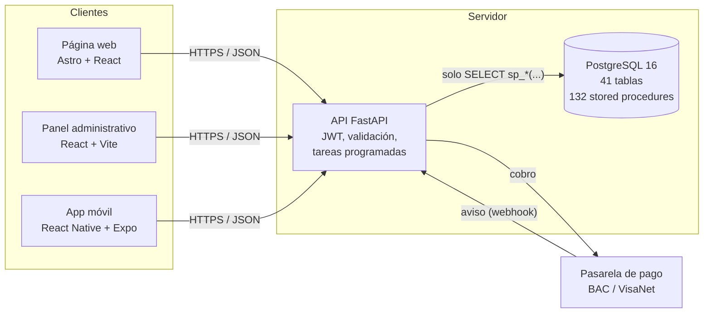
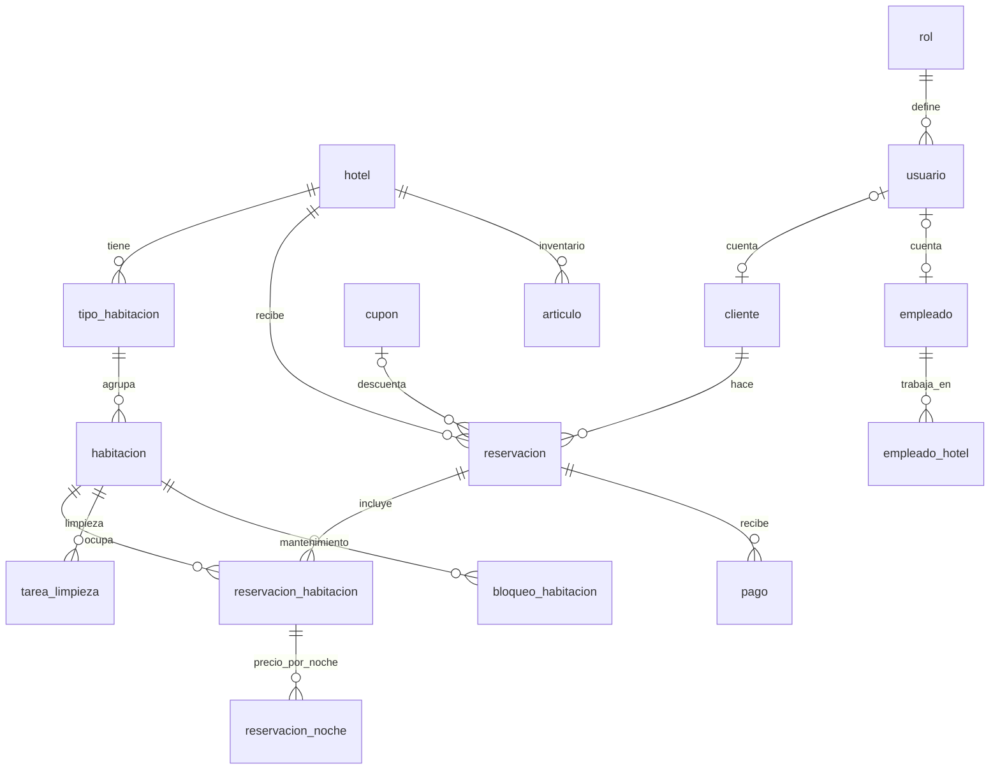

# Hotel Horiani

Sistema de gestión para **Hotel Horiani**, una cadena de 4 hoteles en Guatemala (el principal en Quetzaltenango) que hoy lleva reservaciones, pagos, personal e inventario en papel.

El sistema incluye:

- **Página web pública** con información de los hoteles, habitaciones y servicios.
- **Reservaciones en línea** (web y app móvil) con pago del anticipo por pasarela.
- **Panel administrativo** para recepción, administración, limpieza, lavandería e inventario.
- **App móvil** para clientes y personal.
- **API** que concentra la lógica y se comunica con la base de datos **solo por stored procedures**.

---

## Contenido

1. [Estado del proyecto](#1-estado-del-proyecto)
2. [Fases y fechas de entrega](#2-fases-y-fechas-de-entrega)
3. [Tecnologías](#3-tecnologías)
4. [Arquitectura](#4-arquitectura)
5. [Estructura del repositorio](#5-estructura-del-repositorio)
6. [Requisitos](#6-requisitos)
7. [Instalación y ejecución](#7-instalación-y-ejecución)
8. [Variables de entorno](#8-variables-de-entorno)
9. [Usuarios de prueba](#9-usuarios-de-prueba)
10. [Base de datos](#10-base-de-datos)
11. [Reglas de negocio principales](#11-reglas-de-negocio-principales)
12. [Seguridad](#12-seguridad)
13. [Convenciones de trabajo](#13-convenciones-de-trabajo)
14. [Pendientes con el cliente](#14-pendientes-con-el-cliente)
15. [Problemas comunes](#15-problemas-comunes)

---

## 1. Estado del proyecto

| Parte | Carpeta | Estado |
|---|---|---|
| Base de datos (tablas, stored procedures, datos de prueba) | `db/scripts` | ✅ Terminada y probada |
| Levantamiento con Docker | `docker-compose.yml` | ✅ Terminado |
| API (FastAPI) | `apps/api` | 🔜 Siguiente paso (solo existe `/health`) |
| Página web pública | `apps/web` | 🟡 Páginas informativas hechas (inicio, habitaciones, sobre nosotros); falta conectarla a la API y el flujo de reservación |
| Panel administrativo | `apps/dashboard` | ⏳ Proyecto creado, sin pantallas |
| Tipos compartidos | `packages/shared-types` | ⏳ Creado, vacío |
| App móvil (React Native + Expo) | — | ⏳ Fase 3 |

---

## 2. Fases y fechas de entrega

| Fase | Contenido | Fecha límite |
|---|---|---|
| **Fase 1** | Base de datos + API (backend) | Lunes 30 de noviembre de 2026, 23:59 |
| **Fase 2** | Frontend: página web, reservaciones y panel administrativo | 14 de diciembre de 2026 |
| **Fase 3** | App móvil | 28 de diciembre de 2026 |

---

## 3. Tecnologías

| Parte | Tecnología |
|---|---|
| Base de datos | PostgreSQL 16 (Docker), lógica en stored procedures PL/pgSQL |
| API | Python + FastAPI, Pydantic, Uvicorn (sin ORM: solo llamadas a stored procedures) |
| Página web | Astro 7 con islas de React 19 (GSAP y Motion para animaciones) |
| Reservaciones (dentro de la web) | React 19 + TypeScript |
| Panel administrativo | React 19 + TypeScript + Vite |
| App móvil | React Native + Expo (clientes y personal) |
| Monorepo | pnpm workspaces + `concurrently` |
| Pagos | Pasarela BAC o VisaNet (por definir con el cliente); mientras tanto, pasarela simulada |

> Las librerías exactas de la API (driver de PostgreSQL, hash de contraseñas, JWT, tareas programadas, pruebas) se definen al iniciar la Fase 1 del backend; este README se actualizará en ese momento.

---

## 4. Arquitectura



Principios:

- **Ninguna aplicación toca la base directamente**; solo la API.
- **La API no puede leer ni escribir tablas**: su usuario de base de datos solo puede ejecutar stored procedures. Las reglas críticas (no reservar doble, no cobrar de más, permisos por hotel) las hace cumplir la base de datos.
- **Un solo backend para web, panel y móvil.**
- La base de datos guarda todo en hora de Guatemala (`America/Guatemala`) y en quetzales.

---

## 5. Estructura del repositorio

```
hotel_horiani/
├── apps/
│   ├── api/                 # API FastAPI (Python)
│   │   ├── app/main.py      #   punto de entrada (por ahora solo /health)
│   │   └── requirements.txt
│   ├── web/                 # Página pública (Astro + React)
│   │   ├── src/pages/       #   index, habitaciones, sobre-nosotros
│   │   ├── src/components/  #   home, habitaciones, sobre, servicio, common
│   │   ├── src/data/        #   habitaciones.json, valores.json (se migrarán a la API)
│   │   └── public/images/
│   └── dashboard/           # Panel administrativo (React + Vite)
├── packages/
│   └── shared-types/        # Tipos TypeScript compartidos entre web, panel y móvil
├── db/
│   └── scripts/             # Scripts de la base de datos (ver db/scripts/README.md)
│       ├── 001 … 013        #   estructura: tablas, índices, permisos, usuario de la API
│       ├── 020 … 033        #   stored procedures por módulo
│       ├── 090_semilla.sh   #   carga los datos de prueba si CARGAR_DATOS_PRUEBA=true
│       ├── semilla/
│       └── README.md        #   documentación completa de la base de datos
├── docker-compose.yml       # PostgreSQL 16
├── .env.example             # Plantilla de variables de entorno
├── package.json             # Script "dev" que levanta API + web + panel
└── pnpm-workspace.yaml
```

---

## 6. Requisitos

| Herramienta | Versión | Para qué |
|---|---|---|
| Docker y Docker Compose | Docker 24+ con `docker compose` | Base de datos |
| Node.js | LTS (22 o superior recomendado) | Web y panel |
| pnpm | 9 o superior (el `pnpm-lock.yaml` es formato 9) | Dependencias del monorepo |
| Python | 3.12 o superior (se confirma al iniciar el backend) | API |
| Git | — | — |

---

## 7. Instalación y ejecución

### 7.1 Clonar y configurar

```bash
git clone https://github.com/WilverEmilio/hotel_horiani.git
cd hotel_horiani
cp .env.example .env
```

Abrir `.env` y completar **todas** las variables (ver [sección 8](#8-variables-de-entorno)). Docker no arranca si falta alguna obligatoria.

### 7.2 Base de datos

```bash
docker compose up -d
docker compose logs -f postgres
```

La primera vez, PostgreSQL ejecuta los 28 scripts de `db/scripts` (y los datos de prueba si `CARGAR_DATOS_PRUEBA=true`). Con datos de prueba tarda unos segundos más. Cuando el log muestra `database system is ready to accept connections` después de los scripts, está lista.

Comprobar:

```bash
docker compose ps        # STATUS debe decir "healthy"
docker compose exec postgres psql -U <POSTGRES_USER> -d <POSTGRES_DB> \
  -c "SELECT count(*) AS scripts FROM version_esquema;"
```

Debe dar 28 (29 con datos de prueba).

> **Los scripts solo se ejecutan cuando el volumen está vacío.** Para aplicar cambios en los scripts o cambiar `CARGAR_DATOS_PRUEBA`, hay que recrear la base: `docker compose down -v && docker compose up -d` (esto **borra todos los datos**).

Conexión desde un cliente gráfico (DBeaver, pgAdmin): host `127.0.0.1`, puerto `POSTGRES_PORT`, base `POSTGRES_DB`, usuario `POSTGRES_USER`. El puerto solo se publica en `127.0.0.1`, no en la red.

### 7.3 API

```bash
cd apps/api
python3 -m venv venv
source venv/bin/activate          # Windows: venv\Scripts\activate
pip install -r requirements.txt
uvicorn app.main:app --reload
```

Comprobar: <http://127.0.0.1:8000/health> → `{"status": "ok"}`. Documentación interactiva: <http://127.0.0.1:8000/docs>.

### 7.4 Frontend

Desde la raíz:

```bash
pnpm install
pnpm --filter web dev             # página web
pnpm --filter dashboard dev       # panel administrativo
```

### 7.5 Todo junto

Con la base levantada y el entorno de Python creado en `apps/api/venv`:

```bash
pnpm dev
```

Levanta la API, la web y el panel en paralelo (salidas con prefijo `API`, `WEB`, `DASH`). En Windows, el script usa `venv/bin/uvicorn`; ahí la ruta es `venv\Scripts\uvicorn`, así que conviene levantar la API por separado.

---

## 8. Variables de entorno

Archivo `.env` en la raíz (nunca se sube: está en `.gitignore`). Plantilla en `.env.example`.

| Variable | Obligatoria | Ejemplo | Descripción |
|---|---|---|---|
| `POSTGRES_USER` | Sí | `horiani` | Usuario dueño de la base. Crea tablas y stored procedures. **No lo usa la API** |
| `POSTGRES_PASSWORD` | Sí | — | Contraseña del dueño |
| `POSTGRES_DB` | No (por defecto `hotel_horiani`) | `hotel_horiani` | Nombre de la base |
| `POSTGRES_PORT` | No (por defecto `5432`) | `5432` | Puerto local. Cambiarlo si ya hay otro PostgreSQL en la máquina |
| `API_DB_USER` | Sí | `horiani_app` | Usuario con el que se conecta la API; solo puede ejecutar stored procedures. Debe ser distinto de `POSTGRES_USER` |
| `API_DB_PASSWORD` | Sí | — | Contraseña del usuario de la API |
| `CARGAR_DATOS_PRUEBA` | No (por defecto `false`) | `true` | `true` carga hoteles, habitaciones, personal y meses de reservaciones de prueba. **`false` en producción** |
| `CONTRASENA_DATOS_PRUEBA` | Solo con datos de prueba | — | Contraseña que el backend pondrá a los usuarios de prueba (ver [sección 9](#9-usuarios-de-prueba)) |

> Si `CARGAR_DATOS_PRUEBA` no está en el `.env`, Docker usa `false` y la base queda **sin datos**. Las variables de la API (JWT, pasarela, correo) se agregarán con el backend.

Usar contraseñas largas y distintas. Para generar una:

```bash
python3 -c "import secrets; print(secrets.token_urlsafe(24))"
```

---

## 9. Usuarios de prueba

Solo existen si `CARGAR_DATOS_PRUEBA=true`. Se crean **sin contraseña** (la base de datos no genera hashes de contraseña); cuando esté el backend, al arrancar en desarrollo les pondrá la contraseña de `CONTRASENA_DATOS_PRUEBA`. Hasta entonces no se puede iniciar sesión con ellos.

| Correo | Rol | Puede |
|---|---|---|
| `admin@horiani.test` | Administrador | Todo, en los 4 hoteles |
| `oficinista@horiani.test` | Oficinista | Recepción + asistencia, cupones, reembolsos, reportes (Hotel Horiani) |
| `recepcion@horiani.test`, `recepcion2@horiani.test` | Operador | Reservaciones, check-in/out, cobros, clientes (Hotel Horiani) |
| `recepcion.sede2@horiani.test` … `recepcion.sede4@horiani.test` | Operador | Lo mismo, en su sede |
| `limpieza@horiani.test` | Limpieza | Tareas de limpieza, colocar blancos, consumir insumos |
| `lavanderia@horiani.test` | Lavandería | Lotes de lavandería |
| `cliente@horiani.test`, `cliente1@correo.test` … `cliente80@correo.test` | Cliente | Reservar y ver sus reservaciones |

Datos incluidos: 4 hoteles (46 habitaciones), 401 clientes, 2 634 reservaciones (pasadas y futuras), 4 291 pagos, cupones `BIENVENIDA10`, `XELA50` y `NAVIDAD15`, asistencia, inventario, limpieza y mantenimiento. Detalle en [`db/scripts/README.md`](db/scripts/README.md#12-datos-de-prueba).

---

## 10. Base de datos

**Toda la documentación de la base está en [`db/scripts/README.md`](db/scripts/README.md)**: cómo se ejecutan los scripts, convenciones, seguridad, contrato con la API (errores, paginación, idempotencia, tareas programadas), diagrama entidad-relación, ciclos de vida, matriz de permisos, catálogo de los 132 stored procedures, decisiones técnicas, pruebas realizadas y diccionario de datos.

Resumen:

| | |
|---|---|
| Motor | PostgreSQL 16 |
| Tablas | 41 en 7 áreas: seguridad, hoteles y habitaciones, clientes y personal, reservaciones y pagos, inventario y lavandería, limpieza y mantenimiento, bitácora y contenido web |
| Stored procedures | 132 públicos para la API + 31 rutinas internas |
| Acceso | La API solo ejecuta stored procedures; no tiene permisos sobre tablas |
| Errores | SQLSTATE propio `HH401`, `HH403`, `HH404`, `HH409`, `HH422`, `HH423` → mismo código HTTP |
| Concurrencia | Restricciones de exclusión sobre rangos de fechas + bloqueos de fila: imposible reservar dos veces la misma habitación |



(Diagrama resumido; el completo, con las 41 tablas, está en el README de la base.)

---

## 11. Reglas de negocio principales

Acordadas con el cliente. La versión completa está en el documento de reglas de negocio del proyecto y su implementación en el README de la base.

**Reservaciones**
- Se necesita cuenta para reservar en línea. En recepción se puede registrar un cliente sin cuenta.
- Una reservación puede tener varias habitaciones, todas con las mismas fechas.
- El cliente puede escoger el número de habitación o dejar que el sistema asigne una libre.
- Check-in a cualquier hora desde el día de entrada; check-out a las **11:00**.
- Al reservar en línea la habitación queda apartada **15 minutos** para pagar el anticipo; si no se paga, la reservación expira y la habitación se libera.

**Precios y pagos**
- Precios **fijos** por tipo de habitación, **con IVA incluido**. Solo el administrador los cambia; para feriados hay tarifas especiales por fechas.
- **Un solo total** por reservación. Anticipo del **50 %** (redondeado hacia arriba al centavo; ejemplo: Q85.00 → Q42.50), pagado en línea por pasarela o en el hotel. El resto se paga en el hotel antes del check-out.
- IVA desglosado solo como información: `base = total / 1.12`, `IVA = total − base`. No hay facturación electrónica por ahora.
- La reservación se confirma solo cuando la pasarela avisa al servidor que el pago fue aprobado. No se guardan datos de tarjeta.
- Los únicos descuentos son **cupones** (porcentaje o monto fijo; para toda la cadena, un hotel o un tipo de habitación).

**Personal**
- Roles: administrador, oficinista, operador, limpieza, lavandería (y cliente). Qué puede hacer cada rol está en tablas y se puede cambiar sin programar.
- El administrador ve los 4 hoteles; el resto del personal, solo los hoteles donde trabaja.
- Turnos fijos por hotel (A 08:00–13:00, B 13:00–15:00, C 15:00–18:00, D 18:00–08:00). La asistencia la marca el administrador u oficinista: asistió, llegada tarde, faltó, permiso, descanso, vacaciones, suspensión.

**Operación**
- Al hacer check-out la habitación pasa a limpieza automáticamente.
- Inventario por hotel (sin traslados entre hoteles): insumos (jabón, papel, productos de limpieza) y blancos (toallas, sábanas, fundas). Los blancos se siguen por ubicación: bodega → habitaciones → lavandería → bodega, con registro de faltantes.
- Una habitación en mantenimiento se bloquea por fechas y no se puede reservar.
- Todo cambio queda en la bitácora (quién, qué, cuándo, desde qué IP, valor anterior y nuevo).

---

## 12. Seguridad

- **Credenciales solo en `.env`**, nunca en el código ni en los scripts. `.env` está en `.gitignore`.
- **Dos usuarios de base de datos:** el dueño (solo para crear la base) y el de la API (solo ejecuta stored procedures).
- **Sin SQL armado con texto:** la API llama stored procedures con parámetros; los stored procedures no usan SQL dinámico.
- **Contraseñas con hash** calculado en la API; la base nunca recibe la contraseña.
- **Access token corto + refresh token rotativo** guardado como hash; reutilizar un refresh token cierra todas las sesiones del usuario.
- **5 intentos fallidos** de inicio de sesión bloquean la cuenta 15 minutos.
- **Permisos validados dos veces:** en la API y dentro de cada stored procedure (incluido el hotel).
- **El puerto de PostgreSQL** solo se publica en `127.0.0.1`.
- **Nada se borra:** usuarios, clientes, empleados, reservaciones y pagos tienen triggers que impiden eliminarlos; los pagos y montos de reservaciones no se pueden modificar.

---

## 13. Convenciones de trabajo

### Commits

Mensajes en español con prefijo:

| Prefijo | Uso | Ejemplo |
|---|---|---|
| `Tarea:` | Funcionalidad nueva | `Tarea: se agregaron los procedimientos almacenados de pagos` |
| `FIX:` | Corrección | `FIX: se arregló la ruta de procedimientos almacenados` |

### Base de datos

- Nombres en minúsculas con guion bajo; tablas en singular; llave primaria `id_<tabla>`.
- Stored procedures `sp_<modulo>_<accion>`; parámetros `p_`, variables `v_`.
- Dinero en `DECIMAL(10,2)`; fechas y horas en `TIMESTAMPTZ`.
- Un cambio de estructura en producción = un script nuevo numerado; nunca editar uno ya aplicado. Ver [`db/scripts/README.md`](db/scripts/README.md#16-cómo-agregar-o-cambiar-un-script).

### Código

- Idioma del dominio en español (nombres de tablas, campos, endpoints y mensajes al usuario).
- Montos en quetzales (`Q`), fechas en hora de Guatemala.

---

## 14. Pendientes con el cliente

| Pendiente | Impacto | Mientras tanto |
|---|---|---|
| Política de cancelación y de no presentación | Cuánto se reembolsa | El personal decide el reembolso en cada caso |
| Pasarela de pago: BAC o VisaNet | Integración de pagos en línea | Pasarela simulada |
| Servicio de correo | "Definir contraseña" y "olvidé mi contraseña" | Sin envío de correos |
| Nombres y direcciones de las sedes 2, 3 y 4 | Datos de los hoteles | "Hotel Horiani Sede N", "Dirección por definir" |
| Precios reales por hotel | Tarifas | Q85 / Q150 / Q300 de prueba |

Ninguno requiere cambiar la estructura de la base de datos: todos se configuran con datos.

---

## 15. Problemas comunes

| Síntoma | Causa | Solución |
|---|---|---|
| `Falta POSTGRES_USER en .env` al hacer `docker compose up` | Falta una variable obligatoria | Completar `.env` |
| Cambié un script y no se refleja | Los scripts solo corren con el volumen vacío | `docker compose down -v && docker compose up -d` |
| La base no tiene datos | `CARGAR_DATOS_PRUEBA` no está en `true` (o no estaba al crear el volumen) | Ponerlo en `true` y recrear el volumen |
| `port is already allocated` | Otro PostgreSQL usa el puerto 5432 | Cambiar `POSTGRES_PORT` en `.env` |
| El contenedor no queda `healthy` | Error en un script | `docker compose logs postgres` muestra el script y la línea |
| `permission denied for table ...` conectado como `API_DB_USER` | Es lo esperado: ese usuario solo ejecuta stored procedures | Llamar el `sp_` correspondiente |
| No puedo iniciar sesión con `admin@horiani.test` | Los usuarios de prueba no tienen contraseña hasta que el backend la ponga | Esperar al backend (Fase 1) |
| `pnpm dev` falla en la API | No existe `apps/api/venv` | Crear el entorno virtual (sección 7.3) |