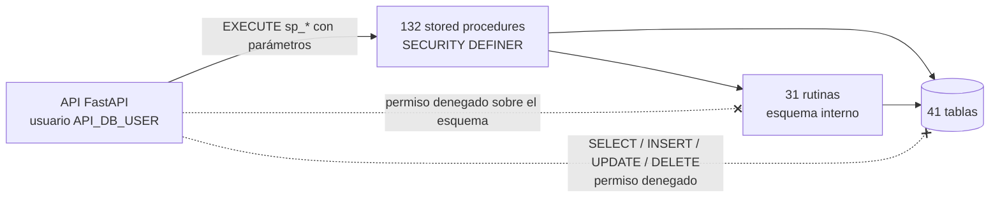
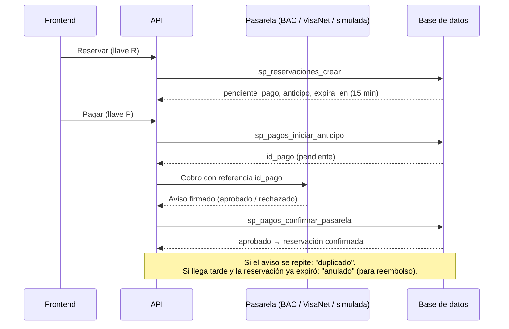
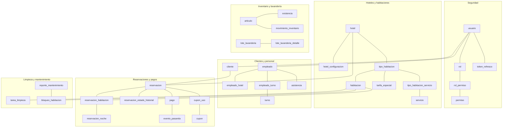
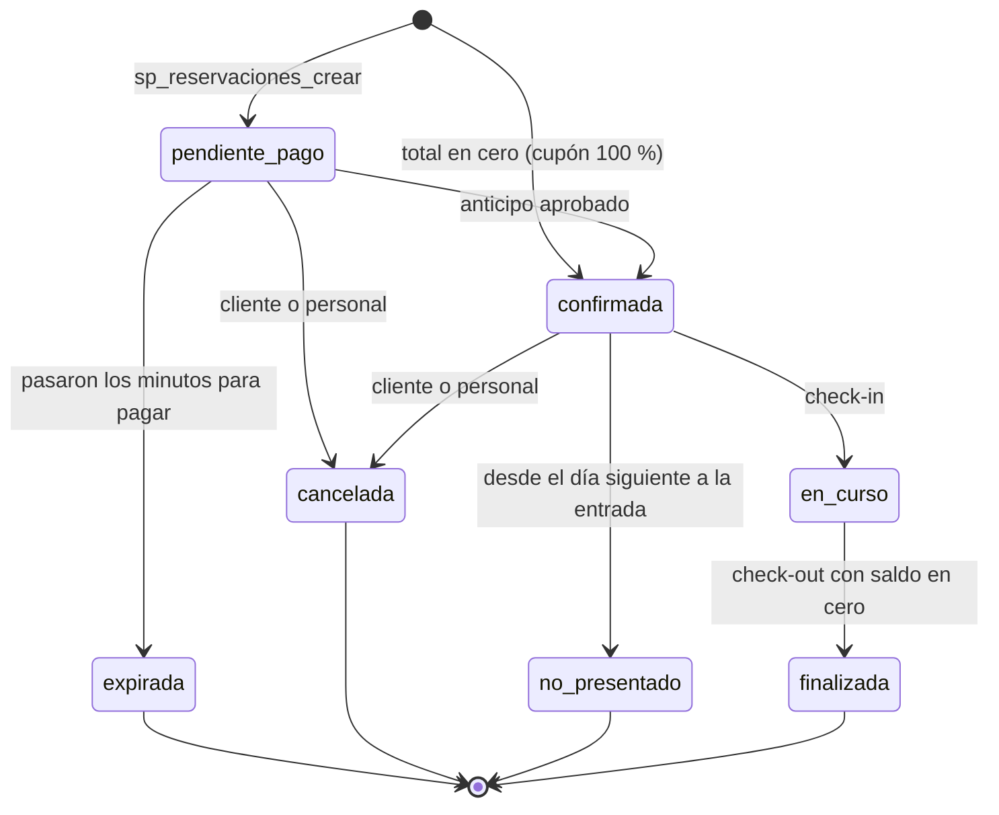

# Base de datos — Hotel Horiani

Scripts SQL que crean desde cero la base de datos del sistema Hotel Horiani en **PostgreSQL 16**: tablas, restricciones, índices, permisos, stored procedures y datos de prueba.

Este documento explica **qué hay, por qué está así y cómo usarlo**. Los scripts no llevan comentarios; toda la explicación vive aquí.

| Objeto | Cantidad |
|---|---|
| Scripts | 28 (`001` a `033`, `013_usuario_api.sh`, `090_semilla.sh`) + `semilla/datos_prueba.sql` |
| Tablas | 41 |
| Vistas | 1 (`vw_cupones_conciliacion`) |
| Stored procedures que puede llamar la API | 132 |
| Rutinas internas (esquema `interno`, la API no las ve) | 31 |
| Triggers | 40 (15 de protección, 25 de `actualizado_en`) |
| Restricciones CHECK | 87 |
| Restricciones de exclusión (EXCLUDE) | 4 |
| Índices | 127 (incluidos los de llaves primarias y UNIQUE) |

## Contenido

1. [Cómo se ejecutan los scripts](#1-cómo-se-ejecutan-los-scripts)
2. [Archivos y orden](#2-archivos-y-orden)
3. [Convenciones](#3-convenciones)
4. [Seguridad del acceso a datos](#4-seguridad-del-acceso-a-datos)
5. [Contrato con la API](#5-contrato-con-la-api)
6. [Modelo de datos](#6-modelo-de-datos)
7. [Reglas que garantiza la base de datos](#7-reglas-que-garantiza-la-base-de-datos)
8. [Ciclos de vida](#8-ciclos-de-vida)
9. [Roles y permisos](#9-roles-y-permisos)
10. [Reglas de negocio por módulo](#10-reglas-de-negocio-por-módulo)
11. [Catálogo de stored procedures](#11-catálogo-de-stored-procedures)
12. [Datos de prueba](#12-datos-de-prueba)
13. [Decisiones técnicas](#13-decisiones-técnicas)
14. [Pruebas realizadas](#14-pruebas-realizadas)
15. [Pendientes con el cliente](#15-pendientes-con-el-cliente)
16. [Cómo agregar o cambiar un script](#16-cómo-agregar-o-cambiar-un-script)
17. [Anexo: diccionario de datos](#17-anexo-diccionario-de-datos)

---

## 1. Cómo se ejecutan los scripts

### Con Docker (forma normal)

`docker-compose.yml` monta esta carpeta en `/docker-entrypoint-initdb.d`. La imagen oficial de PostgreSQL ejecuta ahí, **en orden alfabético y solo cuando la base está vacía** (primer arranque del volumen), todos los `.sql` y `.sh`. Las subcarpetas se ignoran: por eso `semilla/datos_prueba.sql` no se ejecuta solo, lo llama `090_semilla.sh`.

```bash
cp .env.example .env          # y completar las variables (ver README raíz)
docker compose up -d
docker compose logs -f postgres   # debe terminar sin errores
```

Para volver a crear la base desde cero (por ejemplo, después de cambiar un script):

```bash
docker compose down -v        # -v borra el volumen con los datos
docker compose up -d
```

> **Importante:** si el volumen ya existe, Docker **no** vuelve a ejecutar los scripts. Cambiar un `.sql` no tiene efecto hasta hacer `down -v`.

Comprobar que todo se aplicó:

```bash
docker compose exec postgres psql -U "$POSTGRES_USER" -d "$POSTGRES_DB" \
  -c "SELECT script, aplicado_en FROM version_esquema ORDER BY id_version_esquema;"
```

Debe listar los 28 scripts (más `090_semilla.sh (datos de prueba)` si se cargaron).

### Sin Docker

Con un PostgreSQL 16 instalado y un usuario dueño de la base (en estos ejemplos `horiani`):

```bash
createdb -U horiani hotel_horiani
cd db/scripts
for f in 0*.sql; do psql -U horiani -d hotel_horiani -v ON_ERROR_STOP=1 -q -f "$f" || break; done
```

Los dos `.sh` necesitan variables de entorno y se ejecutan en su lugar del orden (`013` después de `012`, `090` al final):

```bash
POSTGRES_USER=horiani POSTGRES_DB=hotel_horiani \
API_DB_USER=horiani_app API_DB_PASSWORD='clave' bash 013_usuario_api.sh

CARGAR_DATOS_PRUEBA=true SEMILLA_DIR=. \
POSTGRES_USER=horiani POSTGRES_DB=hotel_horiani bash 090_semilla.sh
```

> El bucle de arriba ejecuta los `.sql` en orden pero salta los `.sh`; si se usa, correr `013_usuario_api.sh` justo después del `012` y antes de seguir con el `020`.

### Variables de entorno que usan los scripts

| Variable | Usada por | Para qué |
|---|---|---|
| `POSTGRES_USER`, `POSTGRES_PASSWORD`, `POSTGRES_DB` | imagen de PostgreSQL, `013`, `090` | Usuario dueño de la base y nombre de la base |
| `API_DB_USER`, `API_DB_PASSWORD` | `013_usuario_api.sh` | Usuario con el que se conecta la API (solo ejecuta stored procedures) |
| `CARGAR_DATOS_PRUEBA` | `090_semilla.sh` | `true` carga los datos de prueba; cualquier otro valor no |
| `SEMILLA_DIR` | `090_semilla.sh` | Carpeta donde está `semilla/` (en Docker no se define: usa `/docker-entrypoint-initdb.d`) |

---

## 2. Archivos y orden

La numeración deja huecos a propósito: `001`–`013` estructura, `020`–`039` stored procedures, `090` datos.

| Script | Contenido |
|---|---|
| `001_extensiones.sql` | Extensiones `citext` y `btree_gist`, esquema `interno`, tabla `version_esquema` y funciones de trigger comunes (`actualizado_en`, solo inserción, no eliminar) |
| `002_seguridad.sql` | `rol`, `permiso`, `rol_permiso` (con los 6 roles y 24 permisos), `usuario`, `token_refresco` |
| `003_hoteles_habitaciones.sql` | `hotel`, `hotel_configuracion`, `tipo_habitacion`, `tarifa_especial`, `servicio`, `tipo_habitacion_servicio`, `tipo_habitacion_imagen`, `habitacion` |
| `004_clientes_empleados.sql` | `cliente`, `empleado`, `empleado_hotel`, `turno`, `empleado_turno`, `asistencia` |
| `005_cupones.sql` | `cupon` (va antes de reservaciones porque la reservación lo referencia) |
| `006_reservaciones.sql` | `transicion_estado_reservacion`, `reservacion`, `reservacion_habitacion`, `reservacion_noche`, `reservacion_estado_historial`, `cupon_uso`, triggers de protección y la vista `vw_cupones_conciliacion` |
| `007_pagos.sql` | `pago`, `evento_pasarela` y su trigger de protección |
| `008_inventario_lavanderia.sql` | `categoria_articulo`, `articulo`, `existencia`, `lote_lavanderia`, `lote_lavanderia_detalle`, `movimiento_inventario` |
| `009_limpieza_mantenimiento.sql` | `tarea_limpieza`, `reporte_mantenimiento`, `bloqueo_habitacion` |
| `010_bitacora_contenido.sql` | `bitacora`, `contenido_web`, `hotel_imagen` |
| `011_indices.sql` | Índices para llaves foráneas, listados y reportes |
| `012_permisos.sql` | Rol `horiani_api` sin acceso a tablas, esquema `interno` cerrado, sin `EXECUTE` por defecto |
| `013_usuario_api.sh` | Crea el usuario de la API (con la contraseña del `.env`) como miembro de `horiani_api` |
| `020_sp_comun.sql` | Rutinas internas: errores, actor y permisos, hotel, paginación, bitácora |
| `021_sp_seguridad.sql` … `033_sp_bitacora.sql` | Stored procedures por módulo (ver [catálogo](#11-catálogo-de-stored-procedures)) |
| `090_semilla.sh` | Carga `semilla/datos_prueba.sql` solo si `CARGAR_DATOS_PRUEBA=true` |
| `semilla/datos_prueba.sql` | Datos de prueba (ver [sección 12](#12-datos-de-prueba)) |

Cada script termina registrándose en `version_esquema`; si un script se ejecutara dos veces, la restricción UNIQUE lo detiene.

---

## 3. Convenciones

### Nomenclatura

El enunciado pide un estándar de mayúscula inicial (estilo SQL Server). En PostgreSQL los nombres sin comillas se convierten a minúsculas, así que se adoptó **minúsculas con guion bajo** (decisión aprobada con el cliente; ver [decisión 2](#13-decisiones-técnicas)).

| Objeto | Formato | Ejemplo |
|---|---|---|
| Tabla | singular, minúsculas | `reservacion_habitacion` |
| Llave primaria | `id_<tabla>` | `id_reservacion` |
| Llave foránea | mismo nombre que la PK referenciada | `id_hotel` |
| Restricciones | `pk_`, `fk_`, `uq_`, `ck_`, `ex_` + tabla + detalle | `ex_reservacion_habitacion_traslape` |
| Índices | `ix_` (normal), `uq_` (único) + tabla + columnas | `ix_reservacion_hotel_estado` |
| Triggers | `tr_<tabla>_<acción>` y función `tg_<…>` | `tr_pago_proteger` / `tg_pago_proteger` |
| Stored procedures | `sp_<módulo>_<acción>` | `sp_reservaciones_crear` |
| Rutinas internas | `interno.sp_<módulo>_<acción>` | `interno.sp_inventario_mover` |
| Vistas | `vw_<nombre>` | `vw_cupones_conciliacion` |
| Parámetros | `p_<nombre>` | `p_id_usuario_actor` |
| Variables | `v_<nombre>` | `v_total` |

### Tipos de datos

| Dato | Tipo | Motivo |
|---|---|---|
| Dinero | `DECIMAL(10,2)` (totales de reportes `DECIMAL(12,2)`) | Exacto; el enunciado prohíbe FLOAT/REAL |
| Cantidades de inventario | `DECIMAL(12,2)` | Permite galones o litros fraccionados |
| Porcentajes | `DECIMAL(5,2)` | 0.00 a 100.00 |
| Llaves | `BIGINT GENERATED ALWAYS AS IDENTITY` (`SMALLINT` en `rol` y `permiso`) | Estándar SQL, no se pueden insertar a mano por error |
| Fechas de estancia | `DATE` | La estancia es por noches, no por horas |
| Rangos de fechas | `DATERANGE` con formato `[inicio, fin)` | Permite restricciones de exclusión y la operación "se cruza" (`&&`) |
| Momentos | `TIMESTAMPTZ` | Guarda el instante exacto; se muestra en hora de Guatemala |
| Correos y códigos | `CITEXT` | `Ana@Correo.com` y `ana@correo.com` son el mismo |
| Valores flexibles | `JSONB` | Bitácora (valor anterior/nuevo), contenido web, avisos de la pasarela |

### Reglas comunes

- **Nada se borra.** Las tablas de negocio tienen `activo` o un estado terminal. Usuarios, clientes, empleados, reservaciones y pagos además tienen un trigger que **impide** el `DELETE`.
- Toda tabla tiene `creado_en`; las editables tienen `actualizado_en`, que mantiene un trigger.
- Las listas cerradas (estados, tipos, métodos) se validan con `CHECK (... IN (...))`. Solo son tablas catálogo las que el administrador edita (servicios, categorías de artículos) o las que se usan como regla (`transicion_estado_reservacion`, `permiso`).
- Llaves foráneas **compuestas con el hotel** donde mezclar hoteles sería un error: una habitación no puede ser de un tipo de otro hotel, una reservación no puede incluir una habitación de otro hotel, un lote de lavandería no puede incluir artículos de otro hotel.
- Toda fecha "de hoy" se calcula en hora de Guatemala con `interno.sp_comun_hoy()`, aunque el servidor esté en otra zona.

---

## 4. Seguridad del acceso a datos

El enunciado exige que **todo** acceso a datos (crear, editar y leer) sea por stored procedures y que no haya SQL concatenado. Se cumple así:



1. **Tres niveles de usuario en PostgreSQL:**
   - `POSTGRES_USER` (dueño): crea los objetos. Solo lo usan los scripts.
   - `horiani_api` (rol sin inicio de sesión): no tiene permisos sobre tablas ni secuencias, ni sobre el esquema `interno`; solo `EXECUTE` sobre los 132 `sp_*` que cada script otorga explícitamente.
   - `API_DB_USER` (lo crea `013_usuario_api.sh`): inicia sesión y hereda de `horiani_api`. Es el único que va en la configuración de la API.
2. **`SECURITY DEFINER` + `SET search_path = public, pg_temp`:** los stored procedures se ejecutan con los permisos del dueño (por eso pueden tocar las tablas aunque la API no pueda) y con una ruta de búsqueda fija, para que nadie pueda suplantar una tabla o función creando otra con el mismo nombre.
3. **Sin permisos por defecto:** `012_permisos.sql` quita `EXECUTE` a `PUBLIC` sobre toda rutina futura; cada script de stored procedures termina con su `GRANT EXECUTE ... TO horiani_api`.
4. **Sin SQL dinámico:** ningún stored procedure usa `EXECUTE` con texto armado. El orden de los listados se resuelve con `ORDER BY CASE WHEN p_orden = '…'` y una lista blanca de valores válidos; un valor fuera de la lista responde `HH422 orden_invalido`.
5. **Parámetros tipados:** la API llama siempre `SELECT * FROM sp_x($1, $2, …)` con parámetros del driver, nunca concatenando valores.
6. **El usuario que pide la operación se valida en la base**, no solo en la API: cada stored procedure con sesión recibe `p_id_usuario_actor`, carga su rol y permisos (`interno.sp_comun_obtener_actor`) y valida permiso y hotel. Si el usuario fue desactivado, responde `HH401` aunque su access token no haya vencido.

Prueba realizada: conectada como el usuario de la API, `SELECT count(*) FROM reservacion` responde *permission denied* y `SELECT interno.sp_reservaciones_cambiar_estado(...)` responde *permission denied for schema interno*.

---

## 5. Contrato con la API

Lo que la API (Fase 1, backend) debe saber para usar la base.

### Firma de los stored procedures

- Son **funciones** de PostgreSQL. Se llaman con `SELECT * FROM sp_nombre(...)`; los que devuelven un valor simple, con `SELECT sp_nombre(...)`.
- El primer parámetro de todo stored procedure con sesión es `p_id_usuario_actor`: el `id_usuario` que viene en el access token.
- Los públicos (página web sin sesión) no reciben usuario: `sp_hoteles_listar_publico`, `sp_reservaciones_consultar_disponibilidad`, etc.
- Los de sistema no reciben usuario y solo los llama la API por su cuenta: inicio de sesión, rotación de tokens, aviso de la pasarela, tareas programadas.

### Errores

Todo error de negocio se lanza con un **SQLSTATE propio de la clase `HH`**, un mensaje en español listo para mostrar y un **código legible en `DETAIL`**:

| SQLSTATE | HTTP | Cuándo | Ejemplos de código en `DETAIL` |
|---|---|---|---|
| `HH401` | 401 | Usuario inexistente, desactivado o sesión inválida | `sesion_invalida` |
| `HH403` | 403 | Sin permiso o sin acceso al hotel | `sin_permiso`, `hotel_no_permitido`, `consolidado_solo_admin` |
| `HH404` | 404 | No existe, o no pertenece al cliente que lo pide | `reservacion_no_encontrada`, `hotel_no_encontrado` |
| `HH409` | 409 | Conflicto con el estado actual | `habitacion_no_disponible`, `sin_disponibilidad`, `transicion_no_permitida`, `saldo_pendiente`, `ultimo_administrador` |
| `HH422` | 422 | Datos inválidos o regla de negocio no cumplida | `campo_requerido`, `fecha_pasada`, `cupon_vencido`, `monto_excede_saldo`, nombre de la restricción CHECK |
| `HH423` | 423 | Cuenta bloqueada temporalmente | (lo decide la API con `bloqueado_hasta`) |

- Cuando falla una restricción `CHECK`, el `DETAIL` trae su nombre (por ejemplo `ck_cliente_dpi`), para que el frontend marque el campo.
- El error `40P01` (interbloqueo de PostgreSQL) puede ocurrir en alta concurrencia; la API debe **reintentar una vez**. `sp_reservaciones_crear` ya lo convierte en `HH409 reintentar`.
- Un cliente que pide una reservación ajena recibe `HH404` (no `HH403`), para no revelar que existe.

### Paginación, filtros y orden

Los listados reciben `p_pagina` (desde 1), `p_tamano` (1 a 100), `p_orden` (de una lista fija por listado) y `p_direccion` (`asc`/`desc`). Cada fila trae `total_registros` (el total sin paginar) para que el frontend arme el paginador. Todo se resuelve en la base, como pide el enunciado.

### Idempotencia (doble clic y reintentos)

`sp_reservaciones_crear`, `sp_pagos_iniciar_anticipo`, `sp_pagos_registrar_en_hotel` y `sp_pagos_reembolsar` reciben `p_llave_idempotencia` (UUID). El frontend genera **una llave por intento de operación** y la reenvía si repite la petición. La segunda llamada con la misma llave devuelve el resultado de la primera (con `ya_existia = true`) sin crear nada. Los avisos de la pasarela se deduplican por `(pasarela, id_evento_externo)`.

### Dirección IP en la bitácora

Dentro de la misma transacción, antes de llamar el stored procedure:

```sql
SELECT set_config('horiani.ip', '203.0.113.7', true);
```

### Tareas programadas que debe ejecutar la API

| Stored procedure | Frecuencia | Qué hace |
|---|---|---|
| `sp_reservaciones_expirar_pendientes()` | Cada minuto | Vence reservaciones sin anticipo a tiempo y libera sus habitaciones |
| `sp_mantenimiento_sincronizar_estados()` | Diario, 00:05 | Pone "en mantenimiento" las habitaciones cuyo bloqueo empieza hoy |

La disponibilidad no depende de estas tareas (una reservación vencida no se cuenta aunque no se haya procesado y los bloqueos se evalúan por fecha); sirven para que los estados que ve el panel estén al día.

### Inicio de sesión y contraseñas

El hash de contraseñas (Argon2id) se calcula **en la API**; la base solo guarda y devuelve el hash.

1. `sp_seguridad_obtener_credenciales(correo)` → si no hay fila, responder "correo o contraseña incorrectos" (mismo mensaje que contraseña mala).
2. Si `activo = false` → 401. Si `bloqueado_hasta > now()` → 423.
3. Verificar el hash en la API.
4. `sp_seguridad_registrar_intento_login(id_usuario, exitoso)` (5 fallos = 15 minutos de bloqueo).
5. Si fue exitoso: emitir access token (15 min) y refresh token (7 días), y guardar el hash del refresh con `sp_seguridad_crear_token_refresco` (nueva `id_familia`).
6. Al renovar: `sp_seguridad_rotar_token_refresco`. `valido` → entregar el nuevo; `invalido` o `reutilizado` → 401 (en `reutilizado` la base ya cerró todas las sesiones del usuario).

> El frontend debe hacer **un solo refresh a la vez**: dos renovaciones simultáneas con el mismo token se tratan como robo (reutilización) y cierran todas las sesiones.

### Pago en línea en dos pasos



La reservación **solo** se confirma cuando llega el aviso de la pasarela al servidor, nunca porque el navegador diga que el pago salió bien. No se guarda ningún dato de tarjeta.

---

## 6. Modelo de datos

41 tablas en 7 áreas. El diccionario completo (cada columna, tipo, valor por defecto, restricción e índice) está en el [anexo](#17-anexo-diccionario-de-datos).

### Vista general por área



### Qué guarda cada tabla

| Tabla | Qué guarda |
|---|---|
| `version_esquema` | Scripts aplicados (control de versiones de la base) |
| `rol` | Los 6 roles: cliente, administrador, operador, oficinista, limpieza, lavandería |
| `permiso` | Los 24 permisos (acciones) del sistema |
| `rol_permiso` | Qué permisos tiene cada rol |
| `usuario` | Cuenta de acceso: correo, hash de contraseña (puede ser NULL), rol, intentos fallidos, bloqueo |
| `token_refresco` | Hash de cada refresh token, su familia (sesión), expiración y revocación |
| `hotel` | Los hoteles de la cadena (nombre, slug para la URL, dirección, contacto) |
| `hotel_configuracion` | Parámetros por hotel: hora de check-out, % de anticipo, minutos para pagar, política de cancelación |
| `tipo_habitacion` | Individual, Doble, Suite... por hotel, con precio base y capacidad |
| `tarifa_especial` | Precio distinto para un tipo en un rango de fechas (fin de año, feriados) |
| `servicio` | Catálogo de servicios (WiFi, baño privado, TV por cable...) |
| `tipo_habitacion_servicio` | Servicios de cada tipo |
| `tipo_habitacion_imagen` | Fotos de cada tipo |
| `habitacion` | Habitación física: número, piso, tipo y estado operativo |
| `cliente` | Huésped: nombres, documento (DPI o pasaporte), teléfono, país; con o sin usuario |
| `empleado` | Trabajador: DPI, puesto, fecha de ingreso y de baja; con o sin usuario |
| `empleado_hotel` | En qué hotel(es) trabaja cada empleado |
| `turno` | Turnos fijos de cada hotel (pueden cruzar la medianoche) |
| `empleado_turno` | Qué turno tiene cada empleado y desde/hasta cuándo |
| `asistencia` | Control de asistencia por día y turno |
| `cupon` | Cupones de descuento (cadena, hotel o tipo de habitación) |
| `transicion_estado_reservacion` | Cambios de estado permitidos (es la regla, no un catálogo para mostrar) |
| `reservacion` | Encabezado: cliente, hotel, fechas, montos congelados, estado, origen |
| `reservacion_habitacion` | Cada habitación de la reservación, con su periodo y subtotal |
| `reservacion_noche` | Precio de cada noche de cada habitación al momento de reservar |
| `reservacion_estado_historial` | Cada cambio de estado: de, a, quién, cuándo, motivo |
| `cupon_uso` | Uso de un cupón en una reservación (y si se devolvió) |
| `pago` | Anticipos, saldos y reembolsos, por pasarela o en el hotel |
| `evento_pasarela` | Cada aviso recibido de la pasarela (para no procesarlo dos veces) |
| `categoria_articulo` | Categorías de inventario |
| `articulo` | Insumo (jabón, papel, químicos) o blanco (toallas, sábanas, fundas) de un hotel |
| `existencia` | Cantidad de cada artículo en cada ubicación: bodega, habitaciones, lavandería |
| `lote_lavanderia` | Lote de blancos que recibe lavandería |
| `lote_lavanderia_detalle` | Artículos del lote: recibidos, devueltos, faltantes |
| `movimiento_inventario` | Kardex: cada entrada, salida, traslado, ajuste o baja con existencia resultante |
| `tarea_limpieza` | Limpieza de una habitación: quién, cuándo, estado |
| `reporte_mantenimiento` | Daños reportados en habitaciones o áreas comunes |
| `bloqueo_habitacion` | Habitación fuera de venta por fechas (mantenimiento) |
| `bitacora` | Quién hizo qué, cuándo, desde qué IP, con valor anterior y nuevo |
| `contenido_web` | Textos, imágenes y listas editables de la página web |
| `hotel_imagen` | Imágenes del carrusel y la galería de cada hotel |

### Diagrama entidad-relación

Todas las llaves foráneas (sin las columnas de auditoría que apuntan a `usuario`, como `creado_por` o `registrado_por`, para que el diagrama se pueda leer). `||--o{` = obligatoria, `|o--o{` = opcional.

```mermaid
erDiagram
    articulo ||--o{ existencia : tiene
    articulo ||--o{ lote_lavanderia_detalle : tiene
    articulo ||--o{ movimiento_inventario : tiene
    categoria_articulo ||--o{ articulo : tiene
    cliente ||--o{ cupon_uso : tiene
    cliente ||--o{ reservacion : tiene
    cupon ||--o{ cupon_uso : tiene
    cupon |o--o{ reservacion : tiene
    empleado ||--o{ empleado_hotel : tiene
    empleado |o--o{ tarea_limpieza : tiene
    empleado_hotel ||--o{ asistencia : tiene
    empleado_hotel ||--o{ empleado_turno : tiene
    habitacion ||--o{ bloqueo_habitacion : tiene
    habitacion |o--o{ movimiento_inventario : tiene
    habitacion |o--o{ reporte_mantenimiento : tiene
    habitacion ||--o{ reservacion_habitacion : tiene
    habitacion ||--o{ tarea_limpieza : tiene
    hotel ||--o{ articulo : tiene
    hotel |o--o{ bitacora : tiene
    hotel |o--o{ contenido_web : tiene
    hotel |o--o{ cupon : tiene
    hotel ||--o{ empleado_hotel : tiene
    hotel ||--o{ habitacion : tiene
    hotel ||--o{ hotel_configuracion : tiene
    hotel ||--o{ hotel_imagen : tiene
    hotel ||--o{ lote_lavanderia : tiene
    hotel ||--o{ reporte_mantenimiento : tiene
    hotel ||--o{ reservacion : tiene
    hotel ||--o{ tipo_habitacion : tiene
    hotel ||--o{ turno : tiene
    lote_lavanderia ||--o{ lote_lavanderia_detalle : tiene
    lote_lavanderia |o--o{ movimiento_inventario : tiene
    pago |o--o{ evento_pasarela : tiene
    permiso ||--o{ rol_permiso : tiene
    reporte_mantenimiento |o--o{ bloqueo_habitacion : tiene
    reservacion ||--o{ cupon_uso : tiene
    reservacion ||--o{ pago : tiene
    reservacion ||--o{ reservacion_estado_historial : tiene
    reservacion ||--o{ reservacion_habitacion : tiene
    reservacion |o--o{ tarea_limpieza : tiene
    reservacion_habitacion ||--o{ reservacion_noche : tiene
    rol ||--o{ rol_permiso : tiene
    rol ||--o{ usuario : tiene
    servicio ||--o{ tipo_habitacion_servicio : tiene
    tarifa_especial |o--o{ reservacion_noche : tiene
    tipo_habitacion |o--o{ cupon : tiene
    tipo_habitacion ||--o{ habitacion : tiene
    tipo_habitacion ||--o{ reservacion_habitacion : tiene
    tipo_habitacion ||--o{ tarifa_especial : tiene
    tipo_habitacion ||--o{ tipo_habitacion_imagen : tiene
    tipo_habitacion ||--o{ tipo_habitacion_servicio : tiene
    turno |o--o{ asistencia : tiene
    turno ||--o{ empleado_turno : tiene
    usuario |o--o{ cliente : tiene
    usuario |o--o{ empleado : tiene
    usuario ||--o{ token_refresco : tiene
```



---

## 7. Reglas que garantiza la base de datos

El enunciado pide pensar en qué pasa cuando las cosas salen mal. Estas reglas **no dependen de que la API o el frontend estén bien programados**: la base las hace cumplir.

| Riesgo | Cómo lo evita la base |
|---|---|
| Dos clientes reservan la misma habitación al mismo tiempo | `sp_reservaciones_crear` bloquea la fila de la habitación (`FOR UPDATE`) antes de revisar disponibilidad. Como última barrera, `ex_reservacion_habitacion_traslape` (EXCLUDE con `&&` sobre el periodo, solo en reservaciones activas) hace imposible guardar dos estancias cruzadas en la misma habitación |
| Una habitación bloqueada por mantenimiento se vende | La disponibilidad excluye los bloqueos; `sp_mantenimiento_bloquear_habitacion` rechaza si ya hay reservaciones (y dice cuáles). Ambos bloquean la misma fila de habitación, así que no hay carrera |
| Doble clic en "Reservar" o "Pagar" | Llave de idempotencia única + bloqueo consultivo (`pg_advisory_xact_lock`) por llave: la segunda llamada devuelve lo mismo |
| La pasarela envía el mismo aviso dos veces | `uq_evento_pasarela` por `(pasarela, id_evento_externo)`: el segundo responde `duplicado` sin tocar nada |
| El pago llega después de que la reservación expiró | El pago queda `anulado` (para reembolso) y la reservación no revive |
| Se cambia el precio de una habitación y cambian reservaciones viejas | Los precios se copian por noche en `reservacion_noche` al reservar. `tr_reservacion_proteger`, `tr_reservacion_habitacion_proteger` y `tr_reservacion_noche_inmutable` impiden modificar montos y fechas ya guardados |
| Se edita o borra un pago | `tr_pago_no_eliminar` y `tr_pago_proteger`: monto, tipo, método y reservación no cambian; el estado solo avanza (pendiente → aprobado/rechazado/expirado; expirado → anulado/rechazado) |
| Se reembolsa más de lo pagado | `sp_pagos_reembolsar` suma los reembolsos previos del mismo pago con la fila bloqueada |
| Se cobra más que el saldo | `sp_pagos_registrar_en_hotel` valida contra el saldo (`monto_excede_saldo`) |
| Una reservación salta de estado (por ejemplo, de cancelada a en curso) | Toda transición pasa por `interno.sp_reservaciones_cambiar_estado`, que la busca en `transicion_estado_reservacion` |
| Un cupón se usa más veces de las permitidas con clics simultáneos | La fila del cupón se bloquea, el contador se incrementa en la misma transacción y `ck_cupon_usos` impide pasar el límite |
| Dos empleados cobran al mismo tiempo la misma reservación | La reservación se bloquea antes de calcular el saldo |
| Inventario negativo | `ck_existencia_cantidad` (>= 0) y toda salida pasa por `interno.sp_inventario_mover`, que bloquea las existencias en orden fijo (evita interbloqueos) |
| Se borran movimientos de inventario o la bitácora para tapar algo | `tr_movimiento_inventario_inmutable`, `tr_bitacora_inmutable` y triggers que impiden `TRUNCATE` |
| Un empleado de un hotel ve o modifica datos de otro | `interno.sp_comun_exigir_hotel` en cada operación; llaves foráneas compuestas con `id_hotel` |
| Un usuario desactivado sigue operando con su token | `interno.sp_comun_obtener_actor` revisa `activo` en cada llamada (`HH401`) |
| Robo de refresh token | Rotación con detección de reutilización: usar un token ya rotado cierra todas las sesiones |
| Ataque de fuerza bruta al login | 5 intentos fallidos = cuenta bloqueada 15 minutos |
| El sistema queda sin administrador | `interno.sp_empleados_validar_no_ultimo_admin` en cambios de rol, bajas y desactivaciones |
| Un empleado con dos turnos que se cruzan | `ex_empleado_turno_traslape` |
| Dos tarifas especiales para las mismas fechas | `ex_tarifa_especial_traslape` |
| Dos bloqueos sobre la misma habitación y fechas | `ex_bloqueo_habitacion_traslape` |

Triggers de protección (los 25 restantes solo actualizan `actualizado_en`):

| Trigger | Tabla | Qué impide |
|---|---|---|
| `tr_usuario_no_eliminar` | `usuario` | DELETE |
| `tr_cliente_no_eliminar` | `cliente` | DELETE |
| `tr_empleado_no_eliminar` | `empleado` | DELETE |
| `tr_reservacion_no_eliminar` | `reservacion` | DELETE |
| `tr_reservacion_proteger` | `reservacion` | Cambiar código, hotel, cliente, origen, montos (subtotal, descuento, total, IVA, anticipo), cupón o llave; cambiar de estado fuera de las transiciones permitidas |
| `tr_reservacion_habitacion_no_eliminar` | `reservacion_habitacion` | DELETE |
| `tr_reservacion_habitacion_proteger` | `reservacion_habitacion` | Cambiar reservación, hotel, tipo, fechas, huéspedes o subtotal (sí se permite cambiar la habitación: reasignación a otra del mismo tipo) |
| `tr_reservacion_noche_inmutable` | `reservacion_noche` | UPDATE y DELETE |
| `tr_reservacion_estado_historial_inmutable` | `reservacion_estado_historial` | UPDATE y DELETE |
| `tr_pago_no_eliminar` | `pago` | DELETE |
| `tr_pago_proteger` | `pago` | Cambiar monto, tipo, método, reservación o llave; retroceder de estado |
| `tr_movimiento_inventario_inmutable` | `movimiento_inventario` | UPDATE y DELETE |
| `tr_movimiento_inventario_sin_truncate` | `movimiento_inventario` | TRUNCATE |
| `tr_bitacora_inmutable` | `bitacora` | UPDATE y DELETE |
| `tr_bitacora_sin_truncate` | `bitacora` | TRUNCATE |

---

## 8. Ciclos de vida

### Reservación



Estas son exactamente las 7 filas de `transicion_estado_reservacion`. Reservaciones **activas** (ocupan habitación): `pendiente_pago`, `confirmada`, `en_curso`. Al pasar a `expirada`, `cancelada` o `no_presentado` la base libera las habitaciones, devuelve el cupón y marca `expirado` cualquier cobro pendiente.

| Estado | Significado |
|---|---|
| `pendiente_pago` | Creada, esperando el anticipo (15 minutos por defecto; la habitación queda apartada) |
| `confirmada` | Anticipo pagado; o registrada por recepción con anticipo cobrado en el hotel |
| `en_curso` | El huésped hizo check-in |
| `finalizada` | Check-out hecho, saldo en cero |
| `cancelada` | Cancelada antes del check-in (con motivo y autor) |
| `expirada` | No se pagó a tiempo |
| `no_presentado` | Confirmada, pero el huésped no llegó |

### Estado de la habitación

| Estado | Lo pone |
|---|---|
| `disponible` | Al completar la limpieza; cambio manual |
| `ocupada` | Check-in |
| `en_limpieza` | Check-out (crea la tarea) o tarea manual |
| `en_mantenimiento` | Bloqueo que empieza hoy, o limpieza completada mientras hay un bloqueo vigente |
| `fuera_de_servicio` | Cambio manual del personal |

> El estado de la habitación es **operativo** (lo que pasa hoy). La **disponibilidad para reservar** se calcula por fechas con las reservaciones activas y los bloqueos, no con este estado.

### Pago

| Estado | Significado |
|---|---|
| `pendiente` | Cobro en línea iniciado, esperando aviso de la pasarela |
| `aprobado` | Cobrado (los pagos en el hotel nacen aprobados) |
| `rechazado` | La pasarela lo rechazó |
| `expirado` | La reservación venció antes de que llegara el aviso |
| `anulado` | Llegó aprobado pero tarde: el dinero se cobró y se debe reembolsar |

Tipos: `anticipo`, `saldo`, `reembolso` (apunta al pago original con `id_pago_origen`). Métodos: `pasarela`, `efectivo`, `tarjeta_en_hotel`.

### Otros

- **Tarea de limpieza:** `pendiente` → `en_proceso` → `completada`.
- **Reporte de mantenimiento:** `reportado` → `en_proceso` → `resuelto` (requiere la solución; libera los bloqueos del reporte).
- **Lote de lavandería:** `recibido` → `devuelto`.
- **Asistencia:** `asistio`, `llegada_tarde`, `falto` (siempre con turno), `permiso`, `descanso`, `vacaciones`, `suspension` (pueden ser del día completo).

---

## 9. Roles y permisos

Los permisos están **en tablas** (`permiso`, `rol_permiso`), no escritos dentro de los stored procedures. Cada stored procedure pide un permiso; cambiar qué puede hacer un rol es un `INSERT`/`DELETE` en `rol_permiso`, sin tocar código.

| Permiso | administrador | oficinista | operador | limpieza | lavanderia | cliente |
|---|---|---|---|---|---|---|
| `ASISTENCIA_REGISTRAR` | ✓ | ✓ |  |  |  |  |
| `BITACORA_VER` | ✓ |  |  |  |  |  |
| `CLIENTES_GESTIONAR` | ✓ | ✓ | ✓ |  |  |  |
| `CONTENIDO_WEB_GESTIONAR` | ✓ |  |  |  |  |  |
| `CUPONES_GESTIONAR` | ✓ | ✓ |  |  |  |  |
| `EMPLEADOS_GESTIONAR` | ✓ |  |  |  |  |  |
| `HABITACIONES_ESTADO` | ✓ | ✓ | ✓ |  |  |  |
| `HABITACIONES_GESTIONAR` | ✓ |  |  |  |  |  |
| `HABITACIONES_VER` | ✓ | ✓ | ✓ | ✓ |  |  |
| `HOTELES_GESTIONAR` | ✓ |  |  |  |  |  |
| `INSUMOS_CONSUMIR` | ✓ |  |  | ✓ |  |  |
| `INVENTARIO_GESTIONAR` | ✓ |  |  |  |  |  |
| `LAVANDERIA_GESTIONAR` | ✓ |  |  |  | ✓ |  |
| `LIMPIEZA_GESTIONAR` | ✓ |  |  | ✓ |  |  |
| `MANTENIMIENTO_GESTIONAR` | ✓ | ✓ | ✓ |  |  |  |
| `MANTENIMIENTO_REPORTAR` | ✓ | ✓ | ✓ | ✓ | ✓ |  |
| `PAGOS_REEMBOLSAR` | ✓ | ✓ |  |  |  |  |
| `PAGOS_REGISTRAR` | ✓ | ✓ | ✓ |  |  |  |
| `PAGOS_VER` | ✓ | ✓ |  |  |  |  |
| `PRECIOS_GESTIONAR` | ✓ |  |  |  |  |  |
| `REPORTES_VER` | ✓ | ✓ |  |  |  |  |
| `RESERVACIONES_GESTIONAR` | ✓ | ✓ | ✓ |  |  |  |
| `RESERVAR` |  |  |  |  |  | ✓ |
| `USUARIOS_GESTIONAR` | ✓ |  |  |  |  |  |
| **Total** | 23 | 12 | 7 | 4 | 2 | 1 |

Reglas adicionales que no son permisos:

- **El administrador ve los 4 hoteles.** El resto del personal solo los hoteles donde tiene una asignación activa en `empleado_hotel`.
- **Reportes consolidados** (los 4 hoteles juntos, `p_id_hotel = NULL`): solo el administrador.
- **Cupones de cadena** (sin hotel): solo el administrador; el oficinista crea cupones de su hotel.
- **El cliente** solo ve y opera sus propias reservaciones, pagos y perfil.
- Nadie puede cambiarse su propio rol ni desactivarse a sí mismo.

---

## 10. Reglas de negocio por módulo

Las reglas completas acordadas con el cliente están en el documento de reglas de negocio del proyecto. Aquí, cómo quedaron en la base.

### Precios, IVA y anticipo

- Los precios son **fijos** por tipo de habitación y **ya incluyen IVA**. El sistema no calcula precios; solo el administrador los cambia (`PRECIOS_GESTIONAR`), y para feriados usa tarifas especiales por fechas.
- Precio de cada noche: tarifa especial vigente para esa noche si existe; si no, precio base.
- **Un solo total** por reservación: suma de las noches de todas sus habitaciones, menos el cupón.
- IVA desglosado (solo informativo, no hay facturación por ahora):
  - `base_imponible = round(total / 1.12, 2)`
  - `iva = total − base_imponible` (así la suma siempre cuadra al centavo)
- **Anticipo** = 50 % del total (configurable por hotel en `porcentaje_anticipo`), redondeado **hacia arriba** al centavo: `ceil(total × porcentaje) / 100`. Ejemplo del cliente: total Q85.00 → anticipo Q42.50; total Q85.01 → Q42.51.
- El resto se paga en el hotel. El check-out exige saldo en cero.

### Reservaciones

- Cuenta obligatoria para reservar en línea; en recepción se puede registrar un cliente sin cuenta.
- Varias habitaciones por reservación, todas con las mismas fechas.
- Dos formas de escoger habitación, por cada una: **el sistema asigna** una libre del tipo, o **el cliente escoge** el número (`sp_reservaciones_listar_habitaciones_libres`).
- Entrada desde hoy; mínimo una noche; check-in a cualquier hora del día de entrada (o después, mientras no se marque no presentado); check-out a las 11:00 (`hora_checkout`).
- Origen: `web`, `movil` o `recepcion`.
- Sin pago en 15 minutos (`minutos_bloqueo_pago`) la reservación expira y libera la habitación.

### Cancelaciones y no presentado

- `sp_reservaciones_cancelar` devuelve el anticipo pagado y un **reembolso sugerido**: si se cancela con al menos `horas_limite_cancelacion` horas de anticipación se sugiere `porcentaje_reembolso` del pagado; si no, 0.
- **Mientras el cliente no defina la política, esas columnas están en NULL y `reembolso_sugerido` viene NULL**: el personal decide y registra el reembolso con `sp_pagos_reembolsar`.
- `no_presentacion_pierde_anticipo` queda listo para la misma decisión pendiente. Marcar no presentado no mueve dinero.

### Pagos

- Pago en línea en dos pasos (ver [sección 5](#pago-en-línea-en-dos-pasos)). Mientras se elige entre BAC y VisaNet se usa la pasarela `simulada`; el modelo no depende del proveedor.
- En el hotel: efectivo o tarjeta, registrado por el personal (`registrado_por` obligatorio).
- Reembolso = nuevo pago de tipo `reembolso` ligado al original; nunca se modifica el pago original.

### Cupones

- Únicos descuentos del sistema (no hay módulo de promociones).
- Tipo `porcentaje` (hasta 100) o `monto_fijo`. Alcance: toda la cadena, un hotel o un tipo de habitación.
- Vigencia (se revisa contra la fecha en que se usa), monto mínimo, límite total y límite por cliente.
- El descuento se calcula solo sobre las habitaciones a las que aplica y nunca deja el total negativo. Si el total queda en cero, la reservación nace confirmada.
- Al cancelar o expirar, el uso se marca `devuelto` y el cupón recupera ese uso. `vw_cupones_conciliacion` compara el contador con los usos reales.

### Empleados, turnos y asistencia

- Un empleado puede trabajar en varios hoteles. Puede existir sin usuario (no usa el sistema).
- Turnos fijos por hotel; en los datos de prueba A 08:00–13:00, B 13:00–15:00, C 15:00–18:00, D 18:00–08:00 (cruza medianoche).
- La asistencia la marca el administrador u oficinista: es control, no reloj marcador. Rangos de vacaciones, permiso, descanso o suspensión hasta 60 días.
- Dar de baja: desactiva usuario, cierra sesiones y termina sus turnos.

### Inventario y lavandería

- Inventario **por hotel**, sin traslados entre hoteles.
- Tres ubicaciones: `bodega`, `habitaciones`, `lavanderia`. Los **insumos** (jabón, papel, químicos) solo salen de bodega; los **blancos** (toallas, sábanas, fundas) circulan: bodega → habitaciones (limpieza los coloca) → lavandería (recibe lote) → bodega (devuelve lote).
- Lavandería interna: lo que no regresa de un lote se registra como faltante con responsable.
- Conteo físico: registra un ajuste por la diferencia con motivo obligatorio.
- Alertas cuando la existencia en bodega baja del mínimo.
- Todo movimiento queda en `movimiento_inventario` con la existencia resultante (kardex) y no se puede editar.

### Limpieza y mantenimiento

- El check-out crea automáticamente una tarea de limpieza por habitación.
- Completar la limpieza deja la habitación disponible, o en mantenimiento si tiene un bloqueo hoy.
- Bloquear una habitación por mantenimiento la saca de la venta por fechas; resolver el reporte libera sus bloqueos.

### Contenido web

- Bloques editables por página, sección y clave, de tipo `texto`, `texto_largo`, `imagen` o `lista`. Un bloque de un hotel reemplaza al general (`id_hotel` NULL) en la página de ese hotel.
- Imágenes: rutas que empiezan con `/` o URLs `https://`.

### Bitácora

- Toda operación que cambia datos registra usuario, módulo, acción, entidad, id, valor anterior y nuevo (JSONB), IP y fecha. No se puede editar ni borrar.

---

## 11. Catálogo de stored procedures

**Quién lo puede usar** indica el permiso requerido. "Público" = página web sin sesión; "Solo la API" = lo llama el backend por su cuenta (login, tokens, pasarela, tareas programadas), no un usuario. Cuando dice "(propia)", el cliente solo puede hacerlo sobre sus propios datos. El personal además queda limitado a sus hoteles.

Todos los stored procedures con sesión reciben primero `p_id_usuario_actor` (en la tabla se omite de la descripción, pero aparece en los parámetros).

### `021_sp_seguridad.sql` — Seguridad: registro, inicio de sesión, tokens y usuarios

| Stored procedure | Quién lo puede usar | Qué hace | Parámetros | Devuelve |
|---|---|---|---|---|
| `sp_seguridad_registrar_cliente` | Público (sin sesión) | Crea la cuenta de un cliente (usuario + cliente) con el hash de su contraseña. Rechaza correo o documento repetidos. | `p_correo`, `p_contrasena_hash`, `p_nombres`, `p_apellidos`, `p_telefono`, `p_tipo_documento`, `p_numero_documento`, `p_pais` | tabla: id_usuario, id_cliente |
| `sp_seguridad_obtener_credenciales` | Solo la API (sin usuario) | Devuelve hash, rol, activo y bloqueo de un correo para que la API verifique la contraseña. Vacío si no existe. | `p_correo` | tabla: id_usuario, contrasena_hash, rol, activo, bloqueado_hasta |
| `sp_seguridad_registrar_intento_login` | Solo la API (sin usuario) | Registra un intento de inicio de sesión. 5 fallidos seguidos bloquean la cuenta 15 minutos. | `p_id_usuario`, `p_exitoso` | tabla: bloqueado_hasta, intentos_restantes |
| `sp_seguridad_crear_token_refresco` | Solo la API (sin usuario) | Guarda el hash del primer refresh token de una sesión nueva (familia). | `p_id_usuario`, `p_token_hash`, `p_id_familia`, `p_expira_en`, `p_direccion_ip`, `p_agente_usuario` | void |
| `sp_seguridad_rotar_token_refresco` | Solo la API (sin usuario) | Rota el refresh token. Resultado `valido`, `invalido` o `reutilizado` (este último cierra todas las sesiones del usuario). | `p_token_hash_actual`, `p_token_hash_nuevo`, `p_expira_en`, `p_direccion_ip`, `p_agente_usuario` | tabla: resultado, id_usuario, rol, id_familia |
| `sp_seguridad_cerrar_sesion` | Solo la API (sin usuario) | Revoca la familia del token: cierra la sesión del dispositivo actual. | `p_token_hash` | void |
| `sp_seguridad_cerrar_todas_sesiones` | Cualquier usuario con sesión | Revoca todos los refresh tokens del usuario. | `p_id_usuario` | void |
| `sp_seguridad_obtener_perfil` | Cualquier usuario con sesión | Datos del usuario, su rol, sus hoteles y su lista de permisos (para armar los menús). | `p_id_usuario` | tabla: id_usuario, correo, rol, id_cliente, id_empleado, nombres, apellidos, telefono, hoteles, permisos |
| `sp_seguridad_cambiar_contrasena` | Cualquier usuario con sesión | Guarda el nuevo hash (la API verificó la contraseña actual) y cierra todas las sesiones. | `p_id_usuario`, `p_contrasena_hash_nueva` | void |
| `sp_seguridad_cambiar_estado_usuario` | USUARIOS_GESTIONAR | Activa o desactiva un usuario. No a sí mismo ni al último administrador. Desactivar cierra sus sesiones. | `p_id_usuario_actor`, `p_id_usuario`, `p_activo` | void |
| `sp_seguridad_crear_administrador_semilla` | Solo la API (sin usuario) | Crea el primer administrador (para producción, sin datos de prueba). Repetirlo devuelve el mismo id. | `p_correo`, `p_contrasena_hash` | bigint |
| `sp_seguridad_listar_roles` | USUARIOS_GESTIONAR o EMPLEADOS_GESTIONAR | Roles con sus permisos. | `p_id_usuario_actor` | tabla: id_rol, nombre, descripcion, permisos |
| `sp_seguridad_establecer_contrasena_inicial` | Solo la API (sin usuario) | Pone contraseña a un usuario que no tiene (datos de prueba, clientes registrados en recepción). Nunca reemplaza una existente. | `p_correo`, `p_contrasena_hash` | boolean |

### `022_sp_hoteles_habitaciones.sql` — Hoteles, tipos de habitación, precios y habitaciones

| Stored procedure | Quién lo puede usar | Qué hace | Parámetros | Devuelve |
|---|---|---|---|---|
| `sp_hoteles_listar_publico` | Público (sin sesión) | Hoteles activos. | — | tabla: id_hotel, nombre, slug, direccion, ciudad, telefono, correo |
| `sp_hoteles_crear` | HOTELES_GESTIONAR | Crea un hotel y su configuración por defecto (check-out 11:00, anticipo 50 %, 15 min para pagar). | `p_id_usuario_actor`, `p_nombre`, `p_slug`, `p_direccion`, `p_ciudad`, `p_telefono`, `p_correo` | bigint |
| `sp_hoteles_actualizar` | HOTELES_GESTIONAR | Edita datos del hotel o lo desactiva. | `p_id_usuario_actor`, `p_id_hotel`, `p_nombre`, `p_direccion`, `p_ciudad`, `p_telefono`, `p_correo`, `p_activo` | void |
| `sp_hoteles_obtener_configuracion` | HOTELES_GESTIONAR o RESERVACIONES_GESTIONAR | Parámetros del hotel: check-out, anticipo, minutos para pagar y política de cancelación. | `p_id_usuario_actor`, `p_id_hotel` | tabla: id_hotel, hora_checkout, porcentaje_anticipo, minutos_bloqueo_pago, horas_limite_cancelacion, porcentaje_reembolso, no_presentacion_pierde_anticipo |
| `sp_hoteles_actualizar_configuracion` | HOTELES_GESTIONAR | Modifica los parámetros del hotel (incluida la política de cancelación cuando el cliente la defina). | `p_id_usuario_actor`, `p_id_hotel`, `p_hora_checkout`, `p_porcentaje_anticipo`, `p_minutos_bloqueo_pago`, `p_horas_limite_cancelacion`, `p_porcentaje_reembolso`, `p_no_presentacion_pierde_anticipo` | void |
| `sp_servicios_listar_publico` | Público (sin sesión) | Catálogo de servicios (WiFi, TV...). | — | tabla: id_servicio, nombre, icono |
| `sp_servicios_crear` | HABITACIONES_GESTIONAR | Agrega un servicio al catálogo. | `p_id_usuario_actor`, `p_nombre`, `p_icono` | bigint |
| `sp_habitaciones_listar_tipos_publico` | Público (sin sesión) | Tipos de habitación activos de un hotel, con precio base, servicios e imágenes. | `p_id_hotel` | tabla: id_tipo_habitacion, nombre, descripcion, capacidad_maxima, precio_base, servicios, imagenes |
| `sp_habitaciones_crear_tipo` | HABITACIONES_GESTIONAR | Crea un tipo de habitación con su precio base. | `p_id_usuario_actor`, `p_id_hotel`, `p_nombre`, `p_descripcion`, `p_capacidad_maxima`, `p_precio_base` | bigint |
| `sp_habitaciones_actualizar_tipo` | HABITACIONES_GESTIONAR | Edita nombre, descripción, capacidad o activo. No desactiva si hay habitaciones activas del tipo. | `p_id_usuario_actor`, `p_id_tipo_habitacion`, `p_nombre`, `p_descripcion`, `p_capacidad_maxima`, `p_activo` | void |
| `sp_habitaciones_cambiar_precio_base` | PRECIOS_GESTIONAR | Cambia el precio fijo por noche. Queda en bitácora (módulo precios). No afecta reservaciones existentes. | `p_id_usuario_actor`, `p_id_tipo_habitacion`, `p_precio_base` | void |
| `sp_habitaciones_asignar_servicios` | HABITACIONES_GESTIONAR | Deja al tipo exactamente con los servicios indicados. | `p_id_usuario_actor`, `p_id_tipo_habitacion`, `p_ids_servicio` | void |
| `sp_habitaciones_crear_tarifa_especial` | PRECIOS_GESTIONAR | Precio distinto por rango de fechas (primera y última noche incluidas). No se permiten tarifas cruzadas. | `p_id_usuario_actor`, `p_id_tipo_habitacion`, `p_nombre`, `p_fecha_inicio`, `p_fecha_fin`, `p_precio_noche` | bigint |
| `sp_habitaciones_desactivar_tarifa_especial` | PRECIOS_GESTIONAR | Desactiva una tarifa especial. | `p_id_usuario_actor`, `p_id_tarifa_especial` | void |
| `sp_habitaciones_listar_tarifas_especiales` | PRECIOS_GESTIONAR o RESERVACIONES_GESTIONAR | Tarifas especiales de un tipo. | `p_id_usuario_actor`, `p_id_tipo_habitacion`, `p_incluir_inactivas` | tabla: id_tarifa_especial, nombre, fecha_inicio, fecha_fin, precio_noche, activo |
| `sp_habitaciones_crear` | HABITACIONES_GESTIONAR | Crea una habitación física (número único en su hotel). | `p_id_usuario_actor`, `p_id_hotel`, `p_id_tipo_habitacion`, `p_numero`, `p_piso` | bigint |
| `sp_habitaciones_actualizar` | HABITACIONES_GESTIONAR | Cambia tipo, número o piso. | `p_id_usuario_actor`, `p_id_habitacion`, `p_id_tipo_habitacion`, `p_numero`, `p_piso` | void |
| `sp_habitaciones_cambiar_estado` | HABITACIONES_ESTADO | Cambia el estado operativo (disponible, ocupada, en limpieza, en mantenimiento, fuera de servicio). | `p_id_usuario_actor`, `p_id_habitacion`, `p_estado` | void |
| `sp_habitaciones_cambiar_activo` | HABITACIONES_GESTIONAR | Activa o desactiva. No desactiva con reservaciones activas futuras. | `p_id_usuario_actor`, `p_id_habitacion`, `p_activo` | void |
| `sp_habitaciones_listar` | HABITACIONES_VER | Listado paginado del panel, con filtros y orden. | `p_id_usuario_actor`, `p_id_hotel`, `p_estado`, `p_id_tipo_habitacion`, `p_busqueda`, `p_incluir_inactivas`, `p_pagina`, `p_tamano`, `p_orden`, `p_direccion` | tabla: id_habitacion, numero, piso, estado, activo, id_tipo_habitacion, tipo, total_registros |

### `023_sp_reservaciones.sql` — Disponibilidad y reservaciones

| Stored procedure | Quién lo puede usar | Qué hace | Parámetros | Devuelve |
|---|---|---|---|---|
| `sp_reservaciones_expirar_pendientes` | Solo la API (sin usuario) | Vence las reservaciones sin pago a tiempo: libera habitaciones, devuelve cupones y marca expirados sus cobros pendientes. La API lo ejecuta cada minuto. | — | integer |
| `sp_reservaciones_consultar_disponibilidad` | Público (sin sesión) | Por tipo: habitaciones libres, noches y precio de la estancia (con tarifas especiales). | `p_id_hotel`, `p_fecha_entrada`, `p_fecha_salida`, `p_huespedes` | tabla: id_tipo_habitacion, nombre, descripcion, capacidad_maxima, habitaciones_disponibles, noches, precio_estancia, precio_noche_minimo, precio_noche_maximo |
| `sp_reservaciones_listar_habitaciones_libres` | Público (sin sesión) | Números de habitación libres de un tipo, para que el cliente escoja. | `p_id_hotel`, `p_id_tipo_habitacion`, `p_fecha_entrada`, `p_fecha_salida` | tabla: id_habitacion, numero, piso |
| `sp_reservaciones_crear` | RESERVAR o RESERVACIONES_GESTIONAR | Crea la reservación: asigna o valida habitaciones, congela precios, aplica cupón, calcula IVA y anticipo. Idempotente por llave. | `p_id_usuario_actor`, `p_id_hotel`, `p_fecha_entrada`, `p_fecha_salida`, `p_habitaciones`, `p_codigo_cupon`, `p_origen`, `p_llave_idempotencia`, `p_id_cliente` (opcional) | tabla: id_reservacion, codigo, estado, subtotal, descuento, total, base_imponible, iva, monto_anticipo, expira_en, ya_existia |
| `sp_reservaciones_obtener` | RESERVAR (propia) o RESERVACIONES_GESTIONAR | Detalle con habitaciones, precio por noche e historial de estados (este último solo para el personal). | `p_id_usuario_actor`, `p_id_reservacion` | tabla: id_reservacion, codigo, id_hotel, hotel, id_cliente, cliente, fecha_entrada, fecha_salida, noches, estado, origen, subtotal, descuento, total, base_imponible, iva, monto_anticipo, codigo_cupon, expira_en, creado_en, habitaciones, historial |
| `sp_reservaciones_listar_mias` | RESERVAR | Historial del cliente en los 4 hoteles, paginado. | `p_id_usuario_actor`, `p_pagina`, `p_tamano` | tabla: id_reservacion, codigo, hotel, fecha_entrada, fecha_salida, estado, total, monto_anticipo, habitaciones, expira_en, total_registros |
| `sp_reservaciones_listar` | RESERVACIONES_GESTIONAR | Listado paginado del panel con filtros, búsqueda y orden. | `p_id_usuario_actor`, `p_id_hotel`, `p_estado`, `p_id_cliente`, `p_fecha_desde`, `p_fecha_hasta`, `p_busqueda`, `p_pagina`, `p_tamano`, `p_orden`, `p_direccion` | tabla: id_reservacion, codigo, id_cliente, cliente, fecha_entrada, fecha_salida, estado, origen, total, monto_anticipo, habitaciones, creado_en, total_registros |
| `sp_reservaciones_cancelar` | RESERVAR (propia) o RESERVACIONES_GESTIONAR | Cancela una reservación pendiente o confirmada. Devuelve anticipo pagado y reembolso sugerido según la política del hotel. | `p_id_usuario_actor`, `p_id_reservacion`, `p_motivo` | tabla: id_reservacion, estado, anticipo_pagado, reembolso_sugerido |
| `sp_reservaciones_reasignar_habitacion` | RESERVACIONES_GESTIONAR | Cambia una habitación por otra libre del mismo tipo. | `p_id_usuario_actor`, `p_id_reservacion_habitacion`, `p_id_habitacion_nueva`, `p_motivo` | void |

### `024_sp_pagos.sql` — Pagos y reembolsos

| Stored procedure | Quién lo puede usar | Qué hace | Parámetros | Devuelve |
|---|---|---|---|---|
| `sp_pagos_iniciar_anticipo` | RESERVAR (propia) o RESERVACIONES_GESTIONAR | Paso 1 del pago en línea: crea el cobro pendiente por el monto del anticipo. Idempotente por llave. | `p_id_usuario_actor`, `p_id_reservacion`, `p_pasarela`, `p_llave_idempotencia` | tabla: id_pago, monto, estado, expira_en, ya_existia |
| `sp_pagos_confirmar_pasarela` | Solo la API (sin usuario) | Paso 2: procesa el aviso de la pasarela. Resultado `aprobado`, `rechazado`, `anulado` o `duplicado`. Confirma la reservación. | `p_pasarela`, `p_id_evento_externo`, `p_tipo_evento`, `p_contenido`, `p_id_pago`, `p_referencia_pasarela`, `p_monto`, `p_aprobado` | tabla: resultado, id_reservacion, estado_reservacion, estado_pago |
| `sp_pagos_registrar_en_hotel` | PAGOS_REGISTRAR | Cobro en recepción (efectivo o tarjeta): anticipo exacto, o saldo parcial o total. | `p_id_usuario_actor`, `p_id_reservacion`, `p_tipo`, `p_metodo`, `p_monto`, `p_llave_idempotencia` | tabla: id_pago, monto, pagado, saldo, ya_existia |
| `sp_pagos_reembolsar` | PAGOS_REEMBOLSAR | Registra un reembolso ya ejecutado. La suma no puede pasar del pago original. | `p_id_usuario_actor`, `p_id_pago_origen`, `p_monto`, `p_motivo`, `p_referencia_pasarela`, `p_llave_idempotencia` | tabla: id_pago, monto, reembolsado_total, ya_existia |
| `sp_pagos_listar_por_reservacion` | RESERVAR (propia) o RESERVACIONES_GESTIONAR | Pagos de una reservación con total, pagado y saldo. | `p_id_usuario_actor`, `p_id_reservacion` | tabla: id_pago, tipo, metodo, monto, estado, pasarela, id_pago_origen, confirmado_en, creado_en, total_reservacion, pagado, saldo |
| `sp_pagos_listar` | PAGOS_VER | Listado paginado de pagos del hotel. | `p_id_usuario_actor`, `p_id_hotel`, `p_tipo`, `p_metodo`, `p_estado`, `p_fecha_desde`, `p_fecha_hasta`, `p_pagina`, `p_tamano`, `p_orden`, `p_direccion` | tabla: id_pago, id_reservacion, codigo, cliente, tipo, metodo, monto, estado, registrado_por, confirmado_en, creado_en, total_registros |

### `025_sp_estancia.sql` — Estancia: check-in, check-out y no presentado

| Stored procedure | Quién lo puede usar | Qué hace | Parámetros | Devuelve |
|---|---|---|---|---|
| `sp_reservaciones_hacer_checkin` | RESERVACIONES_GESTIONAR | Requiere reservación confirmada, fecha válida y habitaciones disponibles. Las pasa a ocupadas. | `p_id_usuario_actor`, `p_id_reservacion` | tabla: id_reservacion, estado, habitaciones, saldo |
| `sp_reservaciones_hacer_checkout` | RESERVACIONES_GESTIONAR | Requiere saldo en cero. Habitaciones a en limpieza y crea las tareas de limpieza. | `p_id_usuario_actor`, `p_id_reservacion` | tabla: id_reservacion, estado, tareas_limpieza |
| `sp_reservaciones_marcar_no_presentado` | RESERVACIONES_GESTIONAR | A partir del día siguiente a la entrada. Libera habitaciones; no mueve dinero. | `p_id_usuario_actor`, `p_id_reservacion`, `p_observacion` | tabla: id_reservacion, estado, anticipo_pagado, pierde_anticipo |

### `026_sp_clientes.sql` — Clientes

| Stored procedure | Quién lo puede usar | Qué hace | Parámetros | Devuelve |
|---|---|---|---|---|
| `sp_clientes_registrar_en_recepcion` | CLIENTES_GESTIONAR | Registra un cliente con o sin cuenta (con correo: cuenta sin contraseña). | `p_id_usuario_actor`, `p_nombres`, `p_apellidos`, `p_telefono`, `p_tipo_documento`, `p_numero_documento`, `p_pais`, `p_correo` | tabla: id_cliente, id_usuario |
| `sp_clientes_crear_cuenta` | CLIENTES_GESTIONAR | Le crea cuenta (sin contraseña) a un cliente que no tenía. | `p_id_usuario_actor`, `p_id_cliente`, `p_correo` | bigint |
| `sp_clientes_actualizar` | CLIENTES_GESTIONAR | Edición por el personal, incluido el documento. | `p_id_usuario_actor`, `p_id_cliente`, `p_nombres`, `p_apellidos`, `p_telefono`, `p_tipo_documento`, `p_numero_documento`, `p_pais` | void |
| `sp_clientes_actualizar_mi_perfil` | RESERVAR | El cliente edita su nombre, teléfono y país (no el documento). | `p_id_usuario_actor`, `p_nombres`, `p_apellidos`, `p_telefono`, `p_pais` | void |
| `sp_clientes_cambiar_activo` | CLIENTES_GESTIONAR | Activa o desactiva cliente y cuenta. No con reservaciones activas. | `p_id_usuario_actor`, `p_id_cliente`, `p_activo` | void |
| `sp_clientes_obtener` | CLIENTES_GESTIONAR o RESERVAR (propio) | Datos y estadísticas: estancias, noches, total pagado, cancelaciones, no presentaciones. | `p_id_usuario_actor`, `p_id_cliente` | tabla: id_cliente, nombres, apellidos, telefono, tipo_documento, numero_documento, pais, correo, tiene_contrasena, activo, creado_en, estancias, noches, total_pagado, cancelaciones, no_presentaciones, ultima_estancia |
| `sp_clientes_listar` | CLIENTES_GESTIONAR | Listado paginado con estadísticas; orden por nombre, registro, estancias o total pagado. | `p_id_usuario_actor`, `p_busqueda`, `p_activo`, `p_pagina`, `p_tamano`, `p_orden`, `p_direccion` | tabla: id_cliente, nombre, telefono, tipo_documento, numero_documento, correo, activo, estancias, total_pagado, cancelaciones, no_presentaciones, total_registros |

### `027_sp_empleados.sql` — Empleados, turnos y asistencia

| Stored procedure | Quién lo puede usar | Qué hace | Parámetros | Devuelve |
|---|---|---|---|---|
| `sp_empleados_crear` | EMPLEADOS_GESTIONAR | Crea un empleado en uno o varios hoteles; con correo, también su usuario y rol. | `p_id_usuario_actor`, `p_nombres`, `p_apellidos`, `p_dpi`, `p_telefono`, `p_puesto`, `p_fecha_ingreso`, `p_ids_hotel`, `p_correo`, `p_rol`, `p_contrasena_hash` | tabla: id_empleado, id_usuario |
| `sp_empleados_actualizar` | EMPLEADOS_GESTIONAR | Edita nombre, teléfono y puesto. | `p_id_usuario_actor`, `p_id_empleado`, `p_nombres`, `p_apellidos`, `p_telefono`, `p_puesto` | void |
| `sp_empleados_asignar_hoteles` | EMPLEADOS_GESTIONAR | Deja al empleado en los hoteles indicados (desactiva las demás asignaciones). No quita hoteles con turnos vigentes. | `p_id_usuario_actor`, `p_id_empleado`, `p_ids_hotel` | void |
| `sp_empleados_crear_usuario` | EMPLEADOS_GESTIONAR | Da acceso al sistema a un empleado que no tenía. | `p_id_usuario_actor`, `p_id_empleado`, `p_correo`, `p_rol`, `p_contrasena_hash` | bigint |
| `sp_empleados_cambiar_rol` | EMPLEADOS_GESTIONAR | Cambia el rol y cierra sus sesiones. No el propio ni dejar sin administrador. | `p_id_usuario_actor`, `p_id_empleado`, `p_rol` | void |
| `sp_empleados_dar_baja` | EMPLEADOS_GESTIONAR | Desactiva empleado y usuario, cierra sesiones y termina sus turnos en la fecha de baja. | `p_id_usuario_actor`, `p_id_empleado`, `p_fecha_baja` | void |
| `sp_empleados_obtener` | EMPLEADOS_GESTIONAR o ASISTENCIA_REGISTRAR | Ficha con hoteles y turnos. | `p_id_usuario_actor`, `p_id_empleado` | tabla: id_empleado, nombres, apellidos, dpi, telefono, puesto, fecha_ingreso, fecha_baja, activo, id_usuario, correo, rol, usuario_activo, hoteles, turnos |
| `sp_empleados_listar` | EMPLEADOS_GESTIONAR o ASISTENCIA_REGISTRAR | Listado paginado con rol, hoteles y turnos vigentes. | `p_id_usuario_actor`, `p_id_hotel`, `p_busqueda`, `p_activo`, `p_pagina`, `p_tamano`, `p_orden`, `p_direccion` | tabla: id_empleado, nombre, dpi, puesto, fecha_ingreso, activo, correo, rol, hoteles, turnos_vigentes, total_registros |
| `sp_turnos_crear` | EMPLEADOS_GESTIONAR | Crea un turno fijo del hotel (puede cruzar la medianoche). | `p_id_usuario_actor`, `p_id_hotel`, `p_nombre`, `p_hora_inicio`, `p_hora_fin` | bigint |
| `sp_turnos_actualizar` | EMPLEADOS_GESTIONAR | Edita o desactiva un turno (no si tiene empleados vigentes). | `p_id_usuario_actor`, `p_id_turno`, `p_nombre`, `p_hora_inicio`, `p_hora_fin`, `p_activo` | void |
| `sp_turnos_listar` | EMPLEADOS_GESTIONAR o ASISTENCIA_REGISTRAR | Turnos del hotel con cuántos empleados lo tienen hoy. | `p_id_usuario_actor`, `p_id_hotel`, `p_incluir_inactivos` | tabla: id_turno, nombre, hora_inicio, hora_fin, cruza_medianoche, activo, empleados_vigentes |
| `sp_empleados_asignar_turno` | EMPLEADOS_GESTIONAR | Asigna un turno fijo desde una fecha, sin fin. | `p_id_usuario_actor`, `p_id_empleado`, `p_id_turno`, `p_fecha_desde` | bigint |
| `sp_empleados_finalizar_turno` | EMPLEADOS_GESTIONAR | Termina una asignación de turno (último día incluido). | `p_id_usuario_actor`, `p_id_empleado_turno`, `p_fecha_hasta` | void |
| `sp_asistencia_registrar` | ASISTENCIA_REGISTRAR | Registra o corrige la asistencia de un día (por turno o día completo). | `p_id_usuario_actor`, `p_id_empleado`, `p_id_hotel`, `p_fecha`, `p_id_turno`, `p_estado`, `p_observacion` | bigint |
| `sp_asistencia_registrar_rango` | ASISTENCIA_REGISTRAR | Vacaciones, permiso, descanso o suspensión por varios días (máximo 60). | `p_id_usuario_actor`, `p_id_empleado`, `p_id_hotel`, `p_fecha_desde`, `p_fecha_hasta`, `p_estado`, `p_observacion` | integer |
| `sp_asistencia_hoja_del_dia` | ASISTENCIA_REGISTRAR | Empleados con sus turnos de ese día y lo registrado; incluye turnos cubiertos. | `p_id_usuario_actor`, `p_id_hotel`, `p_fecha` | tabla: id_empleado, empleado, puesto, id_turno, turno, hora_inicio, hora_fin, estado, observacion, id_asistencia |
| `sp_asistencia_listar` | ASISTENCIA_REGISTRAR | Registros de asistencia paginados. | `p_id_usuario_actor`, `p_id_hotel`, `p_fecha_desde`, `p_fecha_hasta`, `p_id_empleado`, `p_estado`, `p_pagina`, `p_tamano` | tabla: id_asistencia, fecha, id_empleado, empleado, turno, estado, observacion, registrado_por, actualizado_en, total_registros |
| `sp_asistencia_resumen` | ASISTENCIA_REGISTRAR o REPORTES_VER | Conteo por estado de cada empleado en un periodo. | `p_id_usuario_actor`, `p_id_hotel`, `p_fecha_desde`, `p_fecha_hasta` | tabla: id_empleado, empleado, puesto, asistio, llegada_tarde, falto, permiso, descanso, vacaciones, suspension |

### `028_sp_inventario.sql` — Inventario y lavandería

| Stored procedure | Quién lo puede usar | Qué hace | Parámetros | Devuelve |
|---|---|---|---|---|
| `sp_inventario_crear_categoria` | INVENTARIO_GESTIONAR | Crea una categoría de artículos. | `p_id_usuario_actor`, `p_nombre` | bigint |
| `sp_inventario_listar_categorias` | INVENTARIO_GESTIONAR, INSUMOS_CONSUMIR o LAVANDERIA_GESTIONAR | Categorías activas. | `p_id_usuario_actor` | tabla: id_categoria_articulo, nombre |
| `sp_inventario_crear_articulo` | INVENTARIO_GESTIONAR | Crea un insumo o blanco del hotel con existencias en cero. | `p_id_usuario_actor`, `p_id_hotel`, `p_id_categoria_articulo`, `p_nombre`, `p_clase`, `p_unidad_medida`, `p_existencia_minima` | bigint |
| `sp_inventario_actualizar_articulo` | INVENTARIO_GESTIONAR | Edita el artículo; solo se desactiva con existencia en cero. | `p_id_usuario_actor`, `p_id_articulo`, `p_id_categoria_articulo`, `p_nombre`, `p_unidad_medida`, `p_existencia_minima`, `p_activo` | void |
| `sp_inventario_registrar_entrada` | INVENTARIO_GESTIONAR | Compra o recepción de mercadería a bodega. | `p_id_usuario_actor`, `p_id_articulo`, `p_cantidad`, `p_motivo` | tabla: id_movimiento, existencia_bodega |
| `sp_inventario_registrar_conteo` | INVENTARIO_GESTIONAR | Conteo físico: registra el ajuste por la diferencia (motivo obligatorio). | `p_id_usuario_actor`, `p_id_articulo`, `p_ubicacion`, `p_cantidad_contada`, `p_motivo` | tabla: id_movimiento, existencia_anterior, diferencia |
| `sp_inventario_registrar_consumo` | INSUMOS_CONSUMIR o INVENTARIO_GESTIONAR | Salida de un insumo de bodega (opcionalmente a una habitación). | `p_id_usuario_actor`, `p_id_articulo`, `p_cantidad`, `p_id_habitacion`, `p_motivo` | tabla: id_movimiento, existencia_bodega, bajo_minimo |
| `sp_inventario_colocar_blancos` | LIMPIEZA_GESTIONAR o INVENTARIO_GESTIONAR | Limpieza coloca blancos limpios en una habitación (bodega → habitaciones). | `p_id_usuario_actor`, `p_id_habitacion`, `p_items` | integer |
| `sp_inventario_dar_baja` | INVENTARIO_GESTIONAR o LAVANDERIA_GESTIONAR | Baja por daño o pérdida, con motivo. Lavandería solo blancos. | `p_id_usuario_actor`, `p_id_articulo`, `p_ubicacion`, `p_cantidad`, `p_motivo` | bigint |
| `sp_lavanderia_recibir_lote` | LAVANDERIA_GESTIONAR | Lavandería recibe blancos sucios (habitaciones → lavandería). | `p_id_usuario_actor`, `p_id_hotel`, `p_items`, `p_observacion` | bigint |
| `sp_lavanderia_devolver_lote` | LAVANDERIA_GESTIONAR | Devuelve el lote a bodega; lo que no regresa se registra como faltante con responsable. | `p_id_usuario_actor`, `p_id_lote`, `p_items`, `p_observacion` | tabla: id_articulo, articulo, recibido, devuelto, faltante |
| `sp_lavanderia_listar_lotes` | LAVANDERIA_GESTIONAR o INVENTARIO_GESTIONAR | Lotes paginados con piezas recibidas, devueltas y faltantes. | `p_id_usuario_actor`, `p_id_hotel`, `p_estado`, `p_fecha_desde`, `p_fecha_hasta`, `p_pagina`, `p_tamano` | tabla: id_lote_lavanderia, estado, recibido_en, recibido_por, devuelto_en, devuelto_por, piezas_recibidas, piezas_devueltas, faltante, total_registros |
| `sp_lavanderia_obtener_lote` | LAVANDERIA_GESTIONAR o INVENTARIO_GESTIONAR | Detalle de un lote. | `p_id_usuario_actor`, `p_id_lote` | tabla: id_lote_lavanderia, estado, recibido_en, devuelto_en, observacion, detalle |
| `sp_inventario_listar_existencias` | INVENTARIO_GESTIONAR, INSUMOS_CONSUMIR o LAVANDERIA_GESTIONAR | Existencias por ubicación con alerta de mínimo, paginado. | `p_id_usuario_actor`, `p_id_hotel`, `p_clase`, `p_busqueda`, `p_solo_bajo_minimo`, `p_incluir_inactivos`, `p_pagina`, `p_tamano`, `p_orden`, `p_direccion` | tabla: id_articulo, nombre, categoria, clase, unidad_medida, bodega, habitaciones, lavanderia, total, existencia_minima, bajo_minimo, activo, total_registros |
| `sp_inventario_listar_movimientos` | INVENTARIO_GESTIONAR o LAVANDERIA_GESTIONAR | Kardex con existencia resultante y responsable. | `p_id_usuario_actor`, `p_id_hotel`, `p_id_articulo`, `p_tipo`, `p_fecha_desde`, `p_fecha_hasta`, `p_pagina`, `p_tamano` | tabla: id_movimiento, fecha, id_articulo, articulo, tipo, origen, destino, cantidad, resultante_origen, resultante_destino, motivo, habitacion, id_lote_lavanderia, usuario, total_registros |
| `sp_inventario_alertas` | INVENTARIO_GESTIONAR, INSUMOS_CONSUMIR, LAVANDERIA_GESTIONAR o REPORTES_VER | Artículos bajo el mínimo en bodega. | `p_id_usuario_actor`, `p_id_hotel` | tabla: id_articulo, nombre, clase, unidad_medida, bodega, existencia_minima, faltan |

### `029_sp_limpieza_mantenimiento.sql` — Limpieza y mantenimiento

| Stored procedure | Quién lo puede usar | Qué hace | Parámetros | Devuelve |
|---|---|---|---|---|
| `sp_limpieza_crear_tarea` | HABITACIONES_ESTADO o LIMPIEZA_GESTIONAR | Tarea manual de limpieza; una disponible pasa a en limpieza. | `p_id_usuario_actor`, `p_id_habitacion`, `p_observacion` | bigint |
| `sp_limpieza_asignar_tarea` | HABITACIONES_ESTADO | Asigna la tarea a un empleado activo del hotel. | `p_id_usuario_actor`, `p_id_tarea`, `p_id_empleado` | void |
| `sp_limpieza_tomar_tarea` | LIMPIEZA_GESTIONAR | La persona de limpieza toma la tarea (sin asignar o asignada a ella). | `p_id_usuario_actor`, `p_id_tarea` | void |
| `sp_limpieza_completar_tarea` | LIMPIEZA_GESTIONAR | Completa la tarea; la habitación vuelve a disponible (o en mantenimiento si hay bloqueo hoy). | `p_id_usuario_actor`, `p_id_tarea`, `p_observacion` | tabla: id_habitacion, numero, estado_habitacion |
| `sp_limpieza_listar_tareas` | LIMPIEZA_GESTIONAR o HABITACIONES_VER | Tareas abiertas primero, por llegada más próxima. | `p_id_usuario_actor`, `p_id_hotel`, `p_estado`, `p_solo_mias`, `p_pagina`, `p_tamano` | tabla: id_tarea_limpieza, id_habitacion, habitacion, estado_habitacion, estado, asignada_a, observacion, proxima_llegada, creado_en, completada_en, total_registros |
| `sp_mantenimiento_reportar` | MANTENIMIENTO_REPORTAR o MANTENIMIENTO_GESTIONAR | Reporte de daño en una habitación o área común. | `p_id_usuario_actor`, `p_id_hotel`, `p_id_habitacion`, `p_descripcion` | bigint |
| `sp_mantenimiento_cambiar_estado` | MANTENIMIENTO_GESTIONAR | reportado → en proceso → resuelto (con solución). Resolver libera sus bloqueos. | `p_id_usuario_actor`, `p_id_reporte`, `p_estado`, `p_solucion` | void |
| `sp_mantenimiento_listar_reportes` | MANTENIMIENTO_REPORTAR o MANTENIMIENTO_GESTIONAR | Reportes paginados. | `p_id_usuario_actor`, `p_id_hotel`, `p_estado`, `p_id_habitacion`, `p_pagina`, `p_tamano` | tabla: id_reporte_mantenimiento, habitacion, descripcion, estado, reportado_por, creado_en, solucion, resuelto_por, resuelto_en, bloqueos_activos, total_registros |
| `sp_mantenimiento_bloquear_habitacion` | MANTENIMIENTO_GESTIONAR | Saca una habitación de la venta por fechas. Rechaza si hay reservaciones (dice cuáles). | `p_id_usuario_actor`, `p_id_habitacion`, `p_fecha_inicio`, `p_fecha_fin`, `p_motivo`, `p_id_reporte` | bigint |
| `sp_mantenimiento_liberar_bloqueo` | MANTENIMIENTO_GESTIONAR | Desactiva un bloqueo. | `p_id_usuario_actor`, `p_id_bloqueo` | void |
| `sp_mantenimiento_listar_bloqueos` | MANTENIMIENTO_GESTIONAR, RESERVACIONES_GESTIONAR o HABITACIONES_VER | Bloqueos del hotel en un rango. | `p_id_usuario_actor`, `p_id_hotel`, `p_fecha_desde`, `p_fecha_hasta`, `p_incluir_inactivos` | tabla: id_bloqueo_habitacion, id_habitacion, habitacion, fecha_inicio, fecha_fin, motivo, id_reporte_mantenimiento, activo, creado_por |
| `sp_mantenimiento_sincronizar_estados` | Solo la API (sin usuario) | Pone en mantenimiento las habitaciones con bloqueo que empieza hoy. La API lo ejecuta a las 00:05. | — | integer |

### `030_sp_cupones.sql` — Cupones

| Stored procedure | Quién lo puede usar | Qué hace | Parámetros | Devuelve |
|---|---|---|---|---|
| `sp_cupones_crear` | CUPONES_GESTIONAR | Crea un cupón (de cadena solo el administrador). | `p_id_usuario_actor`, `p_codigo`, `p_descripcion`, `p_tipo`, `p_valor`, `p_fecha_inicio`, `p_fecha_fin`, `p_monto_minimo`, `p_limite_usos_total`, `p_limite_usos_cliente`, `p_id_hotel`, `p_id_tipo_habitacion` | bigint |
| `sp_cupones_actualizar` | CUPONES_GESTIONAR | Edita un cupón; si ya se usó, solo descripción, fecha final, límites y activo. | `p_id_usuario_actor`, `p_id_cupon`, `p_codigo`, `p_descripcion`, `p_tipo`, `p_valor`, `p_fecha_inicio`, `p_fecha_fin`, `p_monto_minimo`, `p_limite_usos_total`, `p_limite_usos_cliente`, `p_id_hotel`, `p_id_tipo_habitacion`, `p_activo` | void |
| `sp_cupones_listar` | CUPONES_GESTIONAR o REPORTES_VER | Cupones con estado calculado y descuento otorgado. | `p_id_usuario_actor`, `p_id_hotel`, `p_busqueda`, `p_estado`, `p_pagina`, `p_tamano` | tabla: id_cupon, codigo, descripcion, tipo, valor, fecha_inicio, fecha_fin, monto_minimo, usos_actuales, limite_usos_total, limite_usos_cliente, hotel, tipo_habitacion, descuento_otorgado, estado, total_registros |
| `sp_cupones_obtener` | CUPONES_GESTIONAR o REPORTES_VER | Detalle con los últimos 50 usos. | `p_id_usuario_actor`, `p_id_cupon` | tabla: id_cupon, codigo, descripcion, tipo, valor, fecha_inicio, fecha_fin, monto_minimo, usos_actuales, limite_usos_total, limite_usos_cliente, id_hotel, id_tipo_habitacion, activo, usos |
| `sp_cupones_vista_previa` | RESERVAR o RESERVACIONES_GESTIONAR | Calcula el descuento antes de reservar, con las mismas reglas que la reservación. No consume el cupón. | `p_id_usuario_actor`, `p_codigo`, `p_id_hotel`, `p_fecha_entrada`, `p_fecha_salida`, `p_habitaciones`, `p_id_cliente` (opcional) | tabla: codigo, descripcion, subtotal, descuento, total |

### `031_sp_contenido_web.sql` — Contenido web e imágenes

| Stored procedure | Quién lo puede usar | Qué hace | Parámetros | Devuelve |
|---|---|---|---|---|
| `sp_hoteles_obtener_publico` | Público (sin sesión) | Hotel por slug con check-out, carrusel y galería. | `p_slug` | tabla: id_hotel, nombre, slug, direccion, ciudad, telefono, correo, hora_checkout, carrusel, galeria |
| `sp_contenido_obtener_publico` | Público (sin sesión) | Contenido publicado de una página (el del hotel reemplaza al general). | `p_slug`, `p_pagina` | tabla: seccion, clave, tipo, valor, orden, de_hotel |
| `sp_contenido_guardar` | CONTENIDO_WEB_GESTIONAR | Crea o reemplaza un bloque de contenido validando su forma. | `p_id_usuario_actor`, `p_id_hotel`, `p_pagina`, `p_seccion`, `p_clave`, `p_tipo`, `p_valor`, `p_orden`, `p_publicado` | bigint |
| `sp_contenido_cambiar_publicado` | CONTENIDO_WEB_GESTIONAR | Publica o despublica un bloque. | `p_id_usuario_actor`, `p_id_contenido_web`, `p_publicado` | void |
| `sp_contenido_listar` | CONTENIDO_WEB_GESTIONAR | Todo el contenido (publicado o no) para el editor. | `p_id_usuario_actor`, `p_id_hotel`, `p_pagina` | tabla: id_contenido_web, pagina, seccion, clave, tipo, valor, orden, publicado, actualizado_por, actualizado_en |
| `sp_hoteles_agregar_imagen` | CONTENIDO_WEB_GESTIONAR | Agrega imagen al carrusel o galería. | `p_id_usuario_actor`, `p_id_hotel`, `p_url`, `p_texto_alternativo`, `p_seccion` | bigint |
| `sp_hoteles_quitar_imagen` | CONTENIDO_WEB_GESTIONAR | Desactiva una imagen del hotel. | `p_id_usuario_actor`, `p_id_hotel_imagen` | void |
| `sp_hoteles_ordenar_imagenes` | CONTENIDO_WEB_GESTIONAR | Reordena las imágenes de una sección. | `p_id_usuario_actor`, `p_id_hotel`, `p_seccion`, `p_ids` | void |
| `sp_habitaciones_agregar_imagen` | CONTENIDO_WEB_GESTIONAR o HABITACIONES_GESTIONAR | Agrega imagen a un tipo de habitación. | `p_id_usuario_actor`, `p_id_tipo_habitacion`, `p_url`, `p_texto_alternativo` | bigint |
| `sp_habitaciones_quitar_imagen` | CONTENIDO_WEB_GESTIONAR o HABITACIONES_GESTIONAR | Quita una imagen del tipo. | `p_id_usuario_actor`, `p_id_tipo_habitacion_imagen` | void |
| `sp_habitaciones_ordenar_imagenes` | CONTENIDO_WEB_GESTIONAR o HABITACIONES_GESTIONAR | Reordena las imágenes del tipo. | `p_id_usuario_actor`, `p_id_tipo_habitacion`, `p_ids` | void |

### `032_sp_reportes.sql` — Reportes y dashboard

| Stored procedure | Quién lo puede usar | Qué hace | Parámetros | Devuelve |
|---|---|---|---|---|
| `sp_reportes_resumen_dashboard` | REPORTES_VER o RESERVACIONES_GESTIONAR | Tarjetas del día: llegadas, salidas, ocupación, limpieza, ingresos, alertas. | `p_id_usuario_actor`, `p_id_hotel` | tabla: fecha, llegadas_hoy, llegadas_pendientes, salidas_hoy, huespedes_en_casa, habitaciones_activas, habitaciones_ocupadas_hoy, ocupacion_hoy, habitaciones_en_limpieza, habitaciones_mantenimiento, pendientes_de_pago, ingresos_hoy, ingresos_mes, tareas_limpieza_abiertas, reportes_abiertos, alertas_inventario |
| `sp_reportes_ingresos` | REPORTES_VER | Ingresos por día, semana o mes con serie completa. | `p_id_usuario_actor`, `p_id_hotel`, `p_fecha_desde`, `p_fecha_hasta`, `p_agrupacion` | tabla: periodo, anticipos, saldos, reembolsos, ingresos, reservaciones, valor_reservado |
| `sp_reportes_ocupacion` | REPORTES_VER | Ocupación por tipo con fila TOTAL, ingreso y tarifa promedio. | `p_id_usuario_actor`, `p_id_hotel`, `p_fecha_desde`, `p_fecha_hasta` | tabla: hotel, tipo_habitacion, habitaciones, noches_disponibles, noches_vendidas, ocupacion, ingreso_por_noches, tarifa_promedio |
| `sp_reportes_ocupacion_diaria` | REPORTES_VER | Ocupación día por día (máximo un año). | `p_id_usuario_actor`, `p_id_hotel`, `p_fecha_desde`, `p_fecha_hasta` | tabla: fecha, disponibles, vendidas, ocupacion |
| `sp_reportes_clientes_frecuentes` | REPORTES_VER | Clientes con más estancias en el periodo. | `p_id_usuario_actor`, `p_id_hotel`, `p_fecha_desde`, `p_fecha_hasta`, `p_limite` | tabla: posicion, id_cliente, cliente, correo, telefono, estancias, noches, total_gastado, ultima_llegada |
| `sp_reportes_cancelaciones` | REPORTES_VER | Canceladas, no presentadas y vencidas: quién, cuándo, motivo, anticipación. | `p_id_usuario_actor`, `p_id_hotel`, `p_fecha_desde`, `p_fecha_hasta`, `p_tipo`, `p_pagina`, `p_tamano` | tabla: id_reservacion, codigo, hotel, cliente, estado, fecha_evento, realizado_por, motivo, fecha_entrada, dias_anticipacion, total, anticipo_pagado, total_registros |
| `sp_reportes_cancelaciones_resumen` | REPORTES_VER | Conteo, valor y anticipación promedio por tipo de pérdida. | `p_id_usuario_actor`, `p_id_hotel`, `p_fecha_desde`, `p_fecha_hasta` | tabla: estado, cantidad, valor, dias_anticipacion_promedio |
| `sp_reportes_cupones` | REPORTES_VER | Usos, devueltos, descuento y ventas por cupón. | `p_id_usuario_actor`, `p_id_hotel`, `p_fecha_desde`, `p_fecha_hasta` | tabla: codigo, tipo, valor, usos, devueltos, descuento_otorgado, ventas_con_cupon |
| `sp_reportes_inventario` | REPORTES_VER | Por artículo: compras, consumo, faltantes, bajas, ajustes y existencia. | `p_id_usuario_actor`, `p_id_hotel`, `p_fecha_desde`, `p_fecha_hasta`, `p_clase` | tabla: id_articulo, articulo, clase, unidad_medida, entradas, consumo, faltantes, otras_bajas, ajustes_neto, existencia_hoy |

### `033_sp_bitacora.sql` — Bitácora

| Stored procedure | Quién lo puede usar | Qué hace | Parámetros | Devuelve |
|---|---|---|---|---|
| `sp_bitacora_listar` | BITACORA_VER | Bitácora paginada con filtros y búsqueda de texto en los valores. | `p_id_usuario_actor`, `p_id_hotel`, `p_modulo`, `p_entidad`, `p_id_registro`, `p_id_usuario`, `p_accion`, `p_fecha_desde`, `p_fecha_hasta`, `p_busqueda`, `p_pagina`, `p_tamano` | tabla: id_bitacora, fecha, usuario, rol, hotel, modulo, entidad, id_registro, accion, valor_anterior, valor_nuevo, direccion_ip, total_registros |
| `sp_bitacora_historial_registro` | BITACORA_VER | Todos los cambios de un registro, del más antiguo al más reciente. | `p_id_usuario_actor`, `p_entidad`, `p_id_registro` | tabla: fecha, usuario, modulo, accion, valor_anterior, valor_nuevo |
| `sp_bitacora_catalogo` | BITACORA_VER | Módulos y entidades existentes (para los filtros). | `p_id_usuario_actor` | tabla: modulo, entidad, registros |

### Rutinas internas

Están en el esquema `interno`; la API no tiene acceso. Las usan los stored procedures para no repetir lógica.

| Rutina (`interno.`) | Script | Qué hace |
|---|---|---|
| `sp_comun_error` | 020 | Lanza un error con SQLSTATE HH4xx, mensaje y código en DETAIL. |
| `sp_comun_hoy` | 020 | Fecha de hoy en Guatemala. |
| `sp_comun_exigir_texto` | 020 | Valida campo obligatorio (HH422). |
| `sp_comun_obtener_actor` | 020 | Carga usuario, rol, cliente, empleado y permisos; HH401 si no existe o está inactivo. |
| `sp_comun_tiene_permiso` | 020 | TRUE si el actor tiene el permiso. |
| `sp_comun_exigir_permiso` | 020 | HH403 si el actor no tiene ninguno de los permisos indicados. |
| `sp_comun_exigir_hotel` | 020 | HH403 si un empleado no trabaja en el hotel (el administrador pasa). |
| `sp_comun_validar_paginacion` | 020 | Página >= 1 y tamaño entre 1 y 100. |
| `sp_comun_validar_direccion` | 020 | Dirección de orden asc o desc. |
| `sp_comun_registrar_bitacora` | 020 | Inserta en bitácora con la IP de `horiani.ip`. |
| `sp_reservaciones_validar_fechas` | 023 | Fechas no pasadas y al menos una noche. |
| `sp_reservaciones_calcular_noches` | 023 | Precio de cada noche (tarifa especial o precio base). |
| `sp_reservaciones_habitacion_libre` | 023 | Habitación activa, sin reservación activa ni bloqueo en el periodo. |
| `sp_reservaciones_cambiar_estado` | 023 | Único punto de cambio de estado: libera habitaciones, devuelve cupón, expira cobros pendientes, historial y bitácora. |
| `sp_reservaciones_exigir_acceso` | 023 | Cliente solo las suyas (HH404); personal las de sus hoteles. |
| `sp_cupones_calcular_descuento` | 023 | Reglas del cupón y descuento (compartida por reservación y vista previa). |
| `sp_pagos_resumen` | 024 | Pagado neto y saldo de una reservación. |
| `sp_clientes_estadisticas` | 026 | Estadísticas de un cliente. |
| `sp_empleados_rol_personal` | 027 | Valida que el rol sea de personal (no cliente). |
| `sp_empleados_validar_no_ultimo_admin` | 027 | Impide dejar el sistema sin administrador activo. |
| `sp_empleados_exigir_acceso` | 027 | El gestor debe tener acceso a todos los hoteles del empleado. |
| `sp_asistencia_guardar` | 027 | Valida y guarda (o corrige) un registro de asistencia. |
| `sp_inventario_mover` | 028 | Único punto que cambia existencias: bloquea, valida, actualiza y registra el movimiento. |
| `sp_inventario_articulo` | 028 | Obtiene el artículo validando el hotel. |
| `sp_inventario_leer_items` | 028 | Lee y valida el JSON de artículos y cantidades. |
| `sp_mantenimiento_estado_libre` | 029 | Estado al liberar una habitación: disponible o en mantenimiento. |
| `sp_limpieza_tarea` | 029 | Obtiene y bloquea una tarea validando el hotel. |
| `sp_cupones_validar_alcance` | 030 | Valida hotel / tipo del cupón según quien lo crea. |
| `sp_contenido_validar_url` | 031 | URL https:// o ruta que empieza con /. |
| `sp_contenido_hotel_por_slug` | 031 | Id del hotel a partir del slug. |
| `sp_reportes_validar` | 032 | Permiso, hotel o consolidado (solo administrador) y periodo válido. |

---

## 12. Datos de prueba

Se cargan solo con `CARGAR_DATOS_PRUEBA=true`. **En producción debe ir en `false`.** Las fechas se generan relativas al día en que se crea la base, así que siempre hay historial (últimos meses) y reservaciones futuras.

### Hoteles y habitaciones

| Hotel | Slug | Habitaciones |
|---|---|---|
| Hotel Horiani | `horiani-quetzaltenango` | 22: 10 Individual (101–110, Q85), 8 Doble (201–208, Q150), 4 Suite Ejecutiva (301–304, Q300) |
| Hotel Horiani Sede 2 | `horiani-sede-2` | 8: 4 Individual, 3 Doble, 1 Suite Ejecutiva |
| Hotel Horiani Sede 3 | `horiani-sede-3` | 8: igual que la Sede 2 |
| Hotel Horiani Sede 4 | `horiani-sede-4` | 8: igual que la Sede 2 |

Los precios son de prueba (Q85 / Q150 / Q300 en los 4 hoteles). Las sedes 2–4 tienen nombre y dirección provisionales ("Dirección por definir") hasta que el cliente los entregue. También hay: servicios (WiFi, baño privado, TV por cable, sala de estar), una tarifa especial "Fin de año" (Doble del hotel principal, 24–31 de diciembre, Q200) y los turnos A–D en cada hotel.

### Usuarios

Todos los usuarios de prueba se crean **sin contraseña** (`contrasena_hash` NULL): la base no puede generar hashes Argon2. El backend, al iniciar en modo desarrollo, les pondrá la contraseña de `CONTRASENA_DATOS_PRUEBA` con `sp_seguridad_establecer_contrasena_inicial` (que nunca reemplaza una contraseña existente).

| Correo | Rol | Hotel(es) |
|---|---|---|
| `admin@horiani.test` | administrador | Los 4 |
| `oficinista@horiani.test` | oficinista | Hotel Horiani |
| `recepcion@horiani.test` | operador | Hotel Horiani |
| `recepcion2@horiani.test` | operador | Hotel Horiani |
| `limpieza@horiani.test` | limpieza | Hotel Horiani |
| `lavanderia@horiani.test` | lavanderia | Hotel Horiani |
| `recepcion.sede2@horiani.test` | operador | Sede 2 |
| `recepcion.sede3@horiani.test` | operador | Sede 3 |
| `recepcion.sede4@horiani.test` | operador | Sede 4 |
| `cliente@horiani.test` | cliente | — |
| `cliente1@correo.test` … `cliente80@correo.test` | cliente | — |

> No asumir ids fijos: buscar el usuario por correo (por ejemplo, el administrador no es necesariamente el id 1).

### Volumen

| Dato | Cantidad |
|---|---|
| Empleados | 12 |
| Clientes | 401 (81 con cuenta) |
| Reservaciones | 2 634: 1 661 finalizadas, 584 confirmadas, 215 canceladas, 78 no presentadas, 63 expiradas, 33 en curso |
| Pagos | 4 291 |
| Asistencia | últimos 30 días |
| Cupones | `BIENVENIDA10`, `XELA50`, `NAVIDAD15` |

Además: inventario con un artículo bajo el mínimo (shampoo) y una toalla faltante en lavandería, tareas de limpieza, un reporte de mantenimiento con bloqueo (habitación 302, dentro de 65 a 67 días) y el contenido de la página web tomado de los archivos actuales de `apps/web` (valores, descripciones, imágenes de la galería).

---

## 13. Decisiones técnicas

| # | Decisión | Por qué |
|---|---|---|
| 1 | **PostgreSQL 16** | Rangos de fechas y restricciones EXCLUDE (imposible reservar doble a nivel de base), JSONB, CITEXT, funciones PL/pgSQL. Imagen oficial de Docker con inicialización automática |
| 2 | **Nombres en minúsculas** con guion bajo en lugar de `Mayúscula_Inicial` | PostgreSQL convierte a minúsculas los nombres sin comillas; usar mayúsculas obligaría a escribir comillas en cada consulta. Se mantiene la idea del estándar (nombres claros, `id_tabla`, prefijos) |
| 3 | **Stored procedures como funciones** (`CREATE FUNCTION`), no `CREATE PROCEDURE` | Los `PROCEDURE` de PostgreSQL no devuelven conjuntos de filas; las funciones sí, y se llaman con `SELECT * FROM`. Se conserva el prefijo `sp_` que pide el enunciado |
| 4 | **Sin ORM** (se quitaron SQLAlchemy y Alembic del plan) | El enunciado exige acceso solo por stored procedures; el ORM no aportaba nada y tentaba a saltarse la regla. Las migraciones son los scripts numerados + `version_esquema` |
| 5 | **Usuario de la API sin acceso a tablas** + `SECURITY DEFINER` | Aunque alguien consiga ejecutar SQL con el usuario de la API, no puede leer ni modificar tablas directamente |
| 6 | **Rutinas internas en esquema aparte** | Funciones como cambiar estado o mover inventario no deben llamarse sueltas, sin las validaciones del stored procedure público |
| 7 | **Validar el actor en la base** (`p_id_usuario_actor`) | Defensa en profundidad: si la API tuviera un error de permisos, la base igual lo detiene; y un usuario desactivado deja de operar de inmediato |
| 8 | **Permisos en tablas** en lugar de roles fijos en el código | El cliente pidió que lo más editable fuera qué hace cada rol (RN-12). Agregar o quitar un permiso no requiere programar |
| 9 | **Errores con SQLSTATE propio (`HH4xx`) y código en DETAIL** | La API traduce a HTTP sin analizar textos; el frontend muestra el mensaje y usa el código para lógica |
| 10 | **Precios congelados por noche** | Cambiar precios o tarifas no altera lo ya reservado y siempre se puede explicar cómo se llegó a un total |
| 11 | **Restricciones EXCLUDE con `btree_gist`** | La garantía contra reservas dobles, turnos o tarifas cruzadas está en la base, no en un `IF` que se puede saltar con concurrencia |
| 12 | **Bloquear la fila de la habitación** antes de revisar disponibilidad | Serializa las reservaciones de la misma habitación sin usar aislamiento SERIALIZABLE en todo el sistema |
| 13 | **Idempotencia con llave del cliente + bloqueo consultivo** | Doble clic y reintentos de red no crean duplicados, sin depender de que el frontend deshabilite botones |
| 14 | **Pago en dos pasos** confirmado solo por aviso del servidor de la pasarela | El navegador puede mentir o cerrarse; el aviso firmado es la única fuente confiable. No se guardan datos de tarjeta |
| 15 | **IVA incluido** y desglosado con `total/1.12` | Los precios del cliente ya son finales; desglosar así hace que base + IVA sume exactamente el total |
| 16 | **Anticipo redondeado hacia arriba** | Nunca se cobra de menos por un centavo |
| 17 | **Nada se borra** (activo, estados terminales, triggers anti-DELETE) | Historial completo para reportes y auditoría; el enunciado pide trazabilidad |
| 18 | **Bitácora genérica en JSONB** | Un solo lugar para auditar todos los módulos, con valor anterior y nuevo, sin una tabla de historial por cada tabla |
| 19 | **Inventario con existencias por ubicación y kardex** | Permite saber dónde están los blancos (bodega, habitaciones, lavandería) y detectar faltantes, que era la preocupación del cliente |
| 20 | **Paginación, filtros y orden en la base** con lista blanca | Lo pide el enunciado; la lista blanca evita SQL dinámico |
| 21 | **Contraseñas con hash en la API (Argon2id)** | Hashing lento y seguro en Python; la base nunca ve la contraseña |
| 22 | **Refresh tokens rotativos guardados como hash** con familias | Si se filtra la base, los tokens no sirven; si se roba un token, la reutilización se detecta |
| 23 | **Datos de prueba controlados por variable** y sin contraseñas | No se pueden colar en producción por accidente y no hay credenciales en el repositorio |
| 24 | **Todo "hoy" en hora de Guatemala** | El servidor puede estar en UTC; las fechas de estancia son locales |
| 25 | **Expiración y sincronización como tareas de la API** en lugar de `pg_cron` | La imagen oficial de PostgreSQL no trae `pg_cron`; la disponibilidad no depende de ellas |

### Qué se tomó del proyecto shopcart

Se revisó la base de datos del proyecto `shopcart` (SQL Server) del mismo autor para reutilizar lo que ya funcionaba. Se trasladaron a PostgreSQL estas ideas:

| shopcart (SQL Server) | Hotel Horiani (PostgreSQL) |
|---|---|
| `Roles`, `Permisos`, `RolesPermisos` | `rol`, `permiso`, `rol_permiso` |
| `Usuarios`, `TokensRefresco` | `usuario`, `token_refresco` (hash, familia, rotación) |
| Usuario de aplicación solo con `EXECUTE` | `horiani_api` + `API_DB_USER`, sin acceso a tablas |
| `VersionesEsquema` | `version_esquema` |
| `Bitacora` | `bitacora` (JSONB, inmutable) |
| `TransicionesEstadoPedido`, `HistorialEstadosPedido` | `transicion_estado_reservacion`, `reservacion_estado_historial` |
| `Cupones`, `UsosCupones` | `cupon`, `cupon_uso` |
| `MovimientosInventario` | `movimiento_inventario` (con ubicaciones y existencia resultante) |
| `Pagos` | `pago` + `evento_pasarela` |

Lo que cambió al pasarlo a PostgreSQL: nombres en minúsculas, `CREATE FUNCTION` en lugar de procedimientos, `SECURITY DEFINER` con `search_path` fijo (en SQL Server el acceso se resuelve por cadena de propiedad), esquema `interno` para las rutinas privadas, y lo propio de un hotel: rangos de fechas con `EXCLUDE`, precios por noche, turnos, asistencia, limpieza y blancos por ubicación.

---

## 14. Pruebas realizadas

La base se construyó desde estos mismos scripts (los del repositorio) en un PostgreSQL 16 limpio, con datos de prueba, y se probó:

- **Flujo completo:** registro → reservación → pago en línea → check-in → cobro del saldo → check-out → limpieza → habitación disponible. También recepción sin cuenta, cancelaciones, expiración y no presentado.
- **Concurrencia real** (varias conexiones simultáneas):
  - Varios clientes reservando la misma habitación a la vez → exactamente 1 reservación; los demás reciben `HH409`.
  - Misma llave de idempotencia en paralelo → 1 reservación, los demás reciben la misma.
  - Avisos de la pasarela repetidos en paralelo → 1 procesado, los demás `duplicado`.
  - Dos cajeros cobrando el saldo a la vez → el segundo rechazado por exceder el saldo.
  - Movimientos cruzados de inventario → sin interbloqueos ni existencias negativas.
  - Bloqueo de mantenimiento contra reservación simultánea → solo uno gana.
- **Seguridad:** el usuario de la API no puede leer tablas ni llamar rutinas internas; un usuario desactivado recibe `HH401`; un empleado no puede operar otro hotel; reutilizar un refresh token cierra todas las sesiones.
- **Consistencia de los datos de prueba:** 9 verificaciones (montos de reservación = suma de noches, IVA y anticipo, saldos, contadores de cupones, existencias = suma del kardex, estados de habitación, etc.) → 0 diferencias.

Tiempos con los datos de prueba:

| Consulta | Tiempo |
|---|---|
| `sp_reportes_resumen_dashboard` | 61 ms |
| `sp_reportes_ocupacion` (consolidado) | 12 ms |
| `sp_reportes_ingresos` | 10 ms |
| Listados paginados (reservaciones, pagos, habitaciones) | 2–9 ms |
| `sp_clientes_listar` | 14 ms (20 ms con 10 000 clientes extra) |

---

## 15. Pendientes con el cliente

| Pendiente | Dónde se configura | Mientras tanto |
|---|---|---|
| Política de cancelación (horas límite, % de reembolso) | `hotel_configuracion` con `sp_hoteles_actualizar_configuracion` | NULL: el reembolso lo decide el personal |
| ¿El no presentado pierde el anticipo? | `hotel_configuracion.no_presentacion_pierde_anticipo` | NULL |
| Pasarela: BAC o VisaNet | API (adaptador) + valor de `pago.pasarela` | Pasarela `simulada` |
| Servicio de correo (definir contraseña, olvidé mi contraseña) | API | Las cuentas creadas en recepción quedan sin contraseña |
| Nombres y direcciones reales de las sedes 2–4 | `sp_hoteles_actualizar` | Datos provisionales |
| Precios reales por hotel y tipo | `sp_habitaciones_cambiar_precio_base` | Q85 / Q150 / Q300 de prueba en los 4 hoteles |
| Nombres de los turnos | `sp_turnos_actualizar` | A, B, C, D |

Ninguno de estos pendientes requiere cambiar la estructura de la base.

---

## 16. Cómo agregar o cambiar un script

1. **Nunca editar un script ya aplicado en producción.** Crear uno nuevo con el siguiente número del rango que corresponda (estructura `014`–`019`, stored procedures `034`–`039`).
2. Seguir la plantilla de un stored procedure:

```sql
CREATE OR REPLACE FUNCTION sp_modulo_accion(
    p_id_usuario_actor BIGINT,
    p_id_hotel         BIGINT,
    p_dato             VARCHAR)
RETURNS TABLE (id_algo BIGINT)
LANGUAGE plpgsql
SECURITY DEFINER
SET search_path = public, pg_temp
AS $$
#variable_conflict use_column
DECLARE
    v_actor interno.tp_actor;
BEGIN
    v_actor := interno.sp_comun_obtener_actor(p_id_usuario_actor);
    PERFORM interno.sp_comun_exigir_permiso(v_actor, 'PERMISO_X');   -- o varios: 'A', 'B'
    PERFORM interno.sp_comun_exigir_hotel(v_actor, p_id_hotel);
    PERFORM interno.sp_comun_exigir_texto(p_dato, 'dato');

    -- ... lógica; errores con interno.sp_comun_error('HH422', 'codigo', 'Mensaje')
    -- ... interno.sp_comun_registrar_bitacora(...) si cambia datos

    RETURN QUERY SELECT ...;
END;
$$;

GRANT EXECUTE ON FUNCTION sp_modulo_accion(BIGINT, BIGINT, VARCHAR) TO horiani_api;
```

3. Si necesita un permiso nuevo: insertarlo en `permiso` y asignarlo en `rol_permiso` en el mismo script.
4. Terminar el script con `INSERT INTO version_esquema (script) VALUES ('0NN_nombre.sql');`.
5. En desarrollo: `docker compose down -v && docker compose up -d` y revisar los logs. En producción: ejecutar solo el script nuevo con `psql -v ON_ERROR_STOP=1 -f`.
6. Actualizar este README (catálogo, diccionario y, si aplica, reglas).

---

## 17. Anexo: diccionario de datos

Columna "Nulo": *no* = obligatoria. "Llave": PK = llave primaria, FK = llave foránea (tabla.columna referenciada).

### Control y seguridad

#### `version_esquema`

| Columna | Tipo | Nulo | Por defecto | Llave |
|---|---|---|---|---|
| `id_version_esquema` | integer | no | `identity` | PK |
| `script` | character varying(100) | no |  |  |
| `aplicado_en` | timestamp with time zone | no | `now()` |  |

Restricciones:
- `uq_version_esquema_script` (UNIQUE): `UNIQUE (script)`

#### `rol`

| Columna | Tipo | Nulo | Por defecto | Llave |
|---|---|---|---|---|
| `id_rol` | smallint | no | `identity` | PK |
| `nombre` | character varying(30) | no |  |  |
| `descripcion` | character varying(200) | no |  |  |
| `creado_en` | timestamp with time zone | no | `now()` |  |

Restricciones:
- `ck_rol_nombre` (CHECK): `CHECK (nombre IN ('cliente', 'administrador', 'operador', 'oficinista', 'limpieza', 'lavanderia'))`
- `uq_rol_nombre` (UNIQUE): `UNIQUE (nombre)`

#### `permiso`

| Columna | Tipo | Nulo | Por defecto | Llave |
|---|---|---|---|---|
| `id_permiso` | smallint | no | `identity` | PK |
| `codigo` | character varying(40) | no |  |  |
| `descripcion` | character varying(200) | no |  |  |
| `creado_en` | timestamp with time zone | no | `now()` |  |

Restricciones:
- `ck_permiso_codigo` (CHECK): `CHECK (((codigo) ~ '^[A-Z]+(_[A-Z]+)*$'))`
- `uq_permiso_codigo` (UNIQUE): `UNIQUE (codigo)`

#### `rol_permiso`

| Columna | Tipo | Nulo | Por defecto | Llave |
|---|---|---|---|---|
| `id_rol` | smallint | no |  | PK FK → `rol` |
| `id_permiso` | smallint | no |  | PK FK → `permiso` |
| `creado_en` | timestamp with time zone | no | `now()` |  |

Índices adicionales: `ix_rol_permiso_permiso`

#### `usuario`

| Columna | Tipo | Nulo | Por defecto | Llave |
|---|---|---|---|---|
| `id_usuario` | bigint | no | `identity` | PK |
| `correo` | citext | no |  |  |
| `contrasena_hash` | character varying(255) | sí |  |  |
| `id_rol` | smallint | no |  | FK → `rol` |
| `intentos_fallidos` | integer | no | `0` |  |
| `bloqueado_hasta` | timestamp with time zone | sí |  |  |
| `activo` | boolean | no | `true` |  |
| `ultimo_acceso_en` | timestamp with time zone | sí |  |  |
| `creado_en` | timestamp with time zone | no | `now()` |  |
| `actualizado_en` | timestamp with time zone | no | `now()` |  |

Restricciones:
- `ck_usuario_correo` (CHECK): `CHECK ((correo ~ '^[^@\s]+@[^@\s]+\.[^@\s]+$'::citext))`
- `ck_usuario_intentos` (CHECK): `CHECK ((intentos_fallidos >= 0))`
- `uq_usuario_correo` (UNIQUE): `UNIQUE (correo)`

Índices adicionales: `ix_usuario_rol`

#### `token_refresco`

| Columna | Tipo | Nulo | Por defecto | Llave |
|---|---|---|---|---|
| `id_token_refresco` | bigint | no | `identity` | PK |
| `id_usuario` | bigint | no |  | FK → `usuario` |
| `token_hash` | character varying(128) | no |  |  |
| `id_familia` | uuid | no |  |  |
| `expira_en` | timestamp with time zone | no |  |  |
| `usado_en` | timestamp with time zone | sí |  |  |
| `revocado_en` | timestamp with time zone | sí |  |  |
| `direccion_ip` | inet | sí |  |  |
| `agente_usuario` | character varying(300) | sí |  |  |
| `creado_en` | timestamp with time zone | no | `now()` |  |

Restricciones:
- `ck_token_refresco_expira` (CHECK): `CHECK ((expira_en > creado_en))`
- `uq_token_refresco_hash` (UNIQUE): `UNIQUE (token_hash)`

Índices adicionales: `ix_token_refresco_familia`, `ix_token_refresco_usuario`

### Hoteles y habitaciones

#### `hotel`

| Columna | Tipo | Nulo | Por defecto | Llave |
|---|---|---|---|---|
| `id_hotel` | bigint | no | `identity` | PK |
| `nombre` | character varying(120) | no |  |  |
| `slug` | character varying(120) | no |  |  |
| `direccion` | character varying(250) | no |  |  |
| `ciudad` | character varying(100) | no |  |  |
| `telefono` | character varying(20) | sí |  |  |
| `correo` | citext | sí |  |  |
| `activo` | boolean | no | `true` |  |
| `creado_en` | timestamp with time zone | no | `now()` |  |
| `actualizado_en` | timestamp with time zone | no | `now()` |  |

Restricciones:
- `ck_hotel_slug` (CHECK): `CHECK (((slug) ~ '^[a-z0-9]+(-[a-z0-9]+)*$'))`
- `uq_hotel_nombre` (UNIQUE): `UNIQUE (nombre)`
- `uq_hotel_slug` (UNIQUE): `UNIQUE (slug)`

#### `hotel_configuracion`

| Columna | Tipo | Nulo | Por defecto | Llave |
|---|---|---|---|---|
| `id_hotel` | bigint | no |  | PK FK → `hotel` |
| `hora_checkout` | time without time zone | no | `'11:00:00'::time without time zone` |  |
| `porcentaje_anticipo` | numeric(5,2) | no | `50.00` |  |
| `minutos_bloqueo_pago` | integer | no | `15` |  |
| `horas_limite_cancelacion` | integer | sí |  |  |
| `porcentaje_reembolso` | numeric(5,2) | sí |  |  |
| `no_presentacion_pierde_anticipo` | boolean | sí |  |  |
| `creado_en` | timestamp with time zone | no | `now()` |  |
| `actualizado_en` | timestamp with time zone | no | `now()` |  |

Restricciones:
- `ck_hotel_configuracion_anticipo` (CHECK): `CHECK (((porcentaje_anticipo > (0)) AND (porcentaje_anticipo <= (100))))`
- `ck_hotel_configuracion_bloqueo` (CHECK): `CHECK ((minutos_bloqueo_pago > 0))`
- `ck_hotel_configuracion_horas` (CHECK): `CHECK (((horas_limite_cancelacion IS NULL) OR (horas_limite_cancelacion >= 0)))`
- `ck_hotel_configuracion_reembolso` (CHECK): `CHECK (((porcentaje_reembolso IS NULL) OR ((porcentaje_reembolso >= (0)) AND (porcentaje_reembolso <= (100)))))`

#### `tipo_habitacion`

| Columna | Tipo | Nulo | Por defecto | Llave |
|---|---|---|---|---|
| `id_tipo_habitacion` | bigint | no | `identity` | PK |
| `id_hotel` | bigint | no |  | FK → `hotel` |
| `nombre` | character varying(80) | no |  |  |
| `descripcion` | text | sí |  |  |
| `capacidad_maxima` | integer | no |  |  |
| `precio_base` | numeric(10,2) | no |  |  |
| `activo` | boolean | no | `true` |  |
| `creado_en` | timestamp with time zone | no | `now()` |  |
| `actualizado_en` | timestamp with time zone | no | `now()` |  |

Restricciones:
- `ck_tipo_habitacion_capacidad` (CHECK): `CHECK ((capacidad_maxima > 0))`
- `ck_tipo_habitacion_precio` (CHECK): `CHECK ((precio_base > (0)))`
- `uq_tipo_habitacion_hotel_nombre` (UNIQUE): `UNIQUE (id_hotel, nombre)`
- `uq_tipo_habitacion_id_hotel` (UNIQUE): `UNIQUE (id_tipo_habitacion, id_hotel)`

#### `tarifa_especial`

| Columna | Tipo | Nulo | Por defecto | Llave |
|---|---|---|---|---|
| `id_tarifa_especial` | bigint | no | `identity` | PK |
| `id_tipo_habitacion` | bigint | no |  | FK → `tipo_habitacion` |
| `nombre` | character varying(100) | no |  |  |
| `periodo` | daterange | no |  |  |
| `precio_noche` | numeric(10,2) | no |  |  |
| `creado_por` | bigint | no |  | FK → `usuario` |
| `activo` | boolean | no | `true` |  |
| `creado_en` | timestamp with time zone | no | `now()` |  |
| `actualizado_en` | timestamp with time zone | no | `now()` |  |

Restricciones:
- `ck_tarifa_especial_periodo` (CHECK): `CHECK (((NOT isempty(periodo)) AND (NOT lower_inf(periodo)) AND (NOT upper_inf(periodo))))`
- `ck_tarifa_especial_precio` (CHECK): `CHECK ((precio_noche > (0)))`
- `ex_tarifa_especial_traslape` (EXCLUDE): `EXCLUDE USING gist (id_tipo_habitacion WITH =, periodo WITH &&) WHERE (activo)`

#### `servicio`

| Columna | Tipo | Nulo | Por defecto | Llave |
|---|---|---|---|---|
| `id_servicio` | bigint | no | `identity` | PK |
| `nombre` | character varying(80) | no |  |  |
| `icono` | character varying(60) | sí |  |  |
| `activo` | boolean | no | `true` |  |
| `creado_en` | timestamp with time zone | no | `now()` |  |

Restricciones:
- `uq_servicio_nombre` (UNIQUE): `UNIQUE (nombre)`

#### `tipo_habitacion_servicio`

| Columna | Tipo | Nulo | Por defecto | Llave |
|---|---|---|---|---|
| `id_tipo_habitacion` | bigint | no |  | PK FK → `tipo_habitacion` |
| `id_servicio` | bigint | no |  | PK FK → `servicio` |
| `creado_en` | timestamp with time zone | no | `now()` |  |

Índices adicionales: `ix_tipo_habitacion_servicio_servicio`

#### `tipo_habitacion_imagen`

| Columna | Tipo | Nulo | Por defecto | Llave |
|---|---|---|---|---|
| `id_tipo_habitacion_imagen` | bigint | no | `identity` | PK |
| `id_tipo_habitacion` | bigint | no |  | FK → `tipo_habitacion` |
| `url` | character varying(500) | no |  |  |
| `texto_alternativo` | character varying(200) | sí |  |  |
| `orden` | integer | no | `0` |  |
| `creado_en` | timestamp with time zone | no | `now()` |  |

Restricciones:
- `ck_tipo_habitacion_imagen_orden` (CHECK): `CHECK ((orden >= 0))`

Índices adicionales: `ix_tipo_habitacion_imagen_tipo`

#### `habitacion`

| Columna | Tipo | Nulo | Por defecto | Llave |
|---|---|---|---|---|
| `id_habitacion` | bigint | no | `identity` | PK |
| `id_hotel` | bigint | no |  | FK → `hotel, tipo_habitacion` |
| `id_tipo_habitacion` | bigint | no |  | FK → `tipo_habitacion` |
| `numero` | character varying(10) | no |  |  |
| `piso` | integer | sí |  |  |
| `estado` | character varying(20) | no | `'disponible'::character varying` |  |
| `activo` | boolean | no | `true` |  |
| `creado_en` | timestamp with time zone | no | `now()` |  |
| `actualizado_en` | timestamp with time zone | no | `now()` |  |

Restricciones:
- `ck_habitacion_estado` (CHECK): `CHECK (estado IN ('disponible', 'ocupada', 'en_limpieza', 'en_mantenimiento', 'fuera_de_servicio'))`
- `uq_habitacion_hotel_numero` (UNIQUE): `UNIQUE (id_hotel, numero)`
- `uq_habitacion_id_hotel` (UNIQUE): `UNIQUE (id_habitacion, id_hotel)`

Índices adicionales: `ix_habitacion_hotel_estado`, `ix_habitacion_tipo`

### Clientes y personal

#### `cliente`

| Columna | Tipo | Nulo | Por defecto | Llave |
|---|---|---|---|---|
| `id_cliente` | bigint | no | `identity` | PK |
| `id_usuario` | bigint | sí |  | FK → `usuario` |
| `nombres` | character varying(100) | no |  |  |
| `apellidos` | character varying(100) | no |  |  |
| `telefono` | character varying(20) | no |  |  |
| `tipo_documento` | character varying(10) | no |  |  |
| `numero_documento` | character varying(30) | no |  |  |
| `pais` | character varying(80) | no | `'Guatemala'::character varying` |  |
| `activo` | boolean | no | `true` |  |
| `creado_en` | timestamp with time zone | no | `now()` |  |
| `actualizado_en` | timestamp with time zone | no | `now()` |  |

Restricciones:
- `ck_cliente_dpi` (CHECK): `CHECK ((((tipo_documento) <> 'dpi') OR ((numero_documento) ~ '^[0-9]{13}$')))`
- `ck_cliente_tipo_documento` (CHECK): `CHECK (tipo_documento IN ('dpi', 'pasaporte'))`
- `uq_cliente_documento` (UNIQUE): `UNIQUE (tipo_documento, numero_documento)`
- `uq_cliente_usuario` (UNIQUE): `UNIQUE (id_usuario)`

Índices adicionales: `ix_cliente_nombre`, `ix_cliente_telefono`

#### `empleado`

| Columna | Tipo | Nulo | Por defecto | Llave |
|---|---|---|---|---|
| `id_empleado` | bigint | no | `identity` | PK |
| `id_usuario` | bigint | sí |  | FK → `usuario` |
| `nombres` | character varying(100) | no |  |  |
| `apellidos` | character varying(100) | no |  |  |
| `dpi` | character varying(13) | no |  |  |
| `telefono` | character varying(20) | sí |  |  |
| `puesto` | character varying(80) | no |  |  |
| `fecha_ingreso` | date | no |  |  |
| `fecha_baja` | date | sí |  |  |
| `activo` | boolean | no | `true` |  |
| `creado_en` | timestamp with time zone | no | `now()` |  |
| `actualizado_en` | timestamp with time zone | no | `now()` |  |

Restricciones:
- `ck_empleado_dpi` (CHECK): `CHECK (((dpi) ~ '^[0-9]{13}$'))`
- `ck_empleado_fechas` (CHECK): `CHECK (((fecha_baja IS NULL) OR (fecha_baja >= fecha_ingreso)))`
- `uq_empleado_dpi` (UNIQUE): `UNIQUE (dpi)`
- `uq_empleado_usuario` (UNIQUE): `UNIQUE (id_usuario)`

#### `empleado_hotel`

| Columna | Tipo | Nulo | Por defecto | Llave |
|---|---|---|---|---|
| `id_empleado` | bigint | no |  | PK FK → `empleado` |
| `id_hotel` | bigint | no |  | PK FK → `hotel` |
| `activo` | boolean | no | `true` |  |
| `creado_en` | timestamp with time zone | no | `now()` |  |
| `actualizado_en` | timestamp with time zone | no | `now()` |  |

Índices adicionales: `ix_empleado_hotel_hotel`

#### `turno`

| Columna | Tipo | Nulo | Por defecto | Llave |
|---|---|---|---|---|
| `id_turno` | bigint | no | `identity` | PK |
| `id_hotel` | bigint | no |  | FK → `hotel` |
| `nombre` | character varying(60) | no |  |  |
| `hora_inicio` | time without time zone | no |  |  |
| `hora_fin` | time without time zone | no |  |  |
| `activo` | boolean | no | `true` |  |
| `creado_en` | timestamp with time zone | no | `now()` |  |
| `actualizado_en` | timestamp with time zone | no | `now()` |  |

Restricciones:
- `ck_turno_horas` (CHECK): `CHECK ((hora_inicio <> hora_fin))`
- `uq_turno_hotel_nombre` (UNIQUE): `UNIQUE (id_hotel, nombre)`
- `uq_turno_id_hotel` (UNIQUE): `UNIQUE (id_turno, id_hotel)`

#### `empleado_turno`

| Columna | Tipo | Nulo | Por defecto | Llave |
|---|---|---|---|---|
| `id_empleado_turno` | bigint | no | `identity` | PK |
| `id_empleado` | bigint | no |  | FK → `empleado_hotel` |
| `id_hotel` | bigint | no |  | FK → `empleado_hotel, turno` |
| `id_turno` | bigint | no |  | FK → `turno` |
| `vigencia` | daterange | no |  |  |
| `creado_por` | bigint | no |  | FK → `usuario` |
| `creado_en` | timestamp with time zone | no | `now()` |  |
| `actualizado_en` | timestamp with time zone | no | `now()` |  |

Restricciones:
- `ck_empleado_turno_vigencia` (CHECK): `CHECK (((NOT isempty(vigencia)) AND (NOT lower_inf(vigencia))))`
- `ex_empleado_turno_traslape` (EXCLUDE): `EXCLUDE USING gist (id_empleado WITH =, id_turno WITH =, vigencia WITH &&)`

Índices adicionales: `ix_empleado_turno_turno`

#### `asistencia`

| Columna | Tipo | Nulo | Por defecto | Llave |
|---|---|---|---|---|
| `id_asistencia` | bigint | no | `identity` | PK |
| `id_empleado` | bigint | no |  | FK → `empleado_hotel` |
| `id_hotel` | bigint | no |  | FK → `empleado_hotel, turno` |
| `id_turno` | bigint | sí |  | FK → `turno` |
| `fecha` | date | no |  |  |
| `estado` | character varying(20) | no |  |  |
| `observacion` | character varying(300) | sí |  |  |
| `registrado_por` | bigint | no |  | FK → `usuario` |
| `creado_en` | timestamp with time zone | no | `now()` |  |
| `actualizado_en` | timestamp with time zone | no | `now()` |  |

Restricciones:
- `ck_asistencia_estado` (CHECK): `CHECK (estado IN ('asistio', 'llegada_tarde', 'falto', 'permiso', 'descanso', 'vacaciones', 'suspension'))`
- `ck_asistencia_turno` (CHECK): `CHECK ((((estado) <> ALL ((ARRAY['asistio', 'llegada_tarde', 'falto']))) OR (id_turno IS NOT NULL)))`
- `uq_asistencia_empleado_fecha_turno` (UNIQUE): `UNIQUE NULLS NOT DISTINCT (id_empleado, id_hotel, fecha, id_turno)`

Índices adicionales: `ix_asistencia_hotel_fecha`

### Reservaciones, cupones y pagos

#### `cupon`

| Columna | Tipo | Nulo | Por defecto | Llave |
|---|---|---|---|---|
| `id_cupon` | bigint | no | `identity` | PK |
| `codigo` | citext | no |  |  |
| `descripcion` | character varying(200) | sí |  |  |
| `tipo` | character varying(15) | no |  |  |
| `valor` | numeric(10,2) | no |  |  |
| `vigencia` | daterange | no |  |  |
| `monto_minimo` | numeric(10,2) | no | `0` |  |
| `limite_usos_total` | integer | sí |  |  |
| `limite_usos_cliente` | integer | sí |  |  |
| `usos_actuales` | integer | no | `0` |  |
| `id_hotel` | bigint | sí |  | FK → `hotel` |
| `id_tipo_habitacion` | bigint | sí |  | FK → `tipo_habitacion` |
| `creado_por` | bigint | no |  | FK → `usuario` |
| `activo` | boolean | no | `true` |  |
| `creado_en` | timestamp with time zone | no | `now()` |  |
| `actualizado_en` | timestamp with time zone | no | `now()` |  |

Restricciones:
- `ck_cupon_codigo` (CHECK): `CHECK ((codigo ~ '^[A-Za-z0-9_-]{3,30}$'::citext))`
- `ck_cupon_limite_cliente` (CHECK): `CHECK (((limite_usos_cliente IS NULL) OR (limite_usos_cliente > 0)))`
- `ck_cupon_limite_total` (CHECK): `CHECK (((limite_usos_total IS NULL) OR (limite_usos_total > 0)))`
- `ck_cupon_monto_minimo` (CHECK): `CHECK ((monto_minimo >= (0)))`
- `ck_cupon_porcentaje` (CHECK): `CHECK ((((tipo) <> 'porcentaje') OR (valor <= (100))))`
- `ck_cupon_tipo` (CHECK): `CHECK (tipo IN ('porcentaje', 'monto_fijo'))`
- `ck_cupon_usos` (CHECK): `CHECK (((usos_actuales >= 0) AND ((limite_usos_total IS NULL) OR (usos_actuales <= limite_usos_total))))`
- `ck_cupon_valor` (CHECK): `CHECK ((valor > (0)))`
- `ck_cupon_vigencia` (CHECK): `CHECK (((NOT isempty(vigencia)) AND (NOT lower_inf(vigencia)) AND (NOT upper_inf(vigencia))))`
- `uq_cupon_codigo` (UNIQUE): `UNIQUE (codigo)`

#### `transicion_estado_reservacion`

| Columna | Tipo | Nulo | Por defecto | Llave |
|---|---|---|---|---|
| `estado_origen` | character varying(20) | no |  | PK |
| `estado_destino` | character varying(20) | no |  | PK |
| `descripcion` | character varying(150) | no |  |  |

Restricciones:
- `ck_transicion_estado_reservacion_estados` (CHECK): `CHECK ((estado_origen IN ('pendiente_pago', 'confirmada', 'en_curso']))) AND ((estado_destino) = ANY ((ARRAY['confirmada', 'en_curso', 'finalizada', 'cancelada', 'expirada', 'no_presentado')))`

#### `reservacion`

| Columna | Tipo | Nulo | Por defecto | Llave |
|---|---|---|---|---|
| `id_reservacion` | bigint | no | `identity` | PK |
| `codigo` | character varying(20) | no |  |  |
| `id_hotel` | bigint | no |  | FK → `hotel` |
| `id_cliente` | bigint | no |  | FK → `cliente` |
| `fecha_entrada` | date | no |  |  |
| `fecha_salida` | date | no |  |  |
| `estado` | character varying(20) | no | `'pendiente_pago'::character varying` |  |
| `origen` | character varying(15) | no |  |  |
| `creado_por` | bigint | no |  | FK → `usuario` |
| `subtotal` | numeric(10,2) | no |  |  |
| `descuento` | numeric(10,2) | no | `0` |  |
| `total` | numeric(10,2) | no |  |  |
| `base_imponible` | numeric(10,2) | no |  |  |
| `iva` | numeric(10,2) | no |  |  |
| `monto_anticipo` | numeric(10,2) | no |  |  |
| `id_cupon` | bigint | sí |  | FK → `cupon` |
| `codigo_cupon` | character varying(30) | sí |  |  |
| `expira_en` | timestamp with time zone | sí |  |  |
| `llave_idempotencia` | uuid | no |  |  |
| `checkin_en` | timestamp with time zone | sí |  |  |
| `checkout_en` | timestamp with time zone | sí |  |  |
| `cancelada_en` | timestamp with time zone | sí |  |  |
| `motivo_cancelacion` | character varying(300) | sí |  |  |
| `creado_en` | timestamp with time zone | no | `now()` |  |
| `actualizado_en` | timestamp with time zone | no | `now()` |  |

Restricciones:
- `ck_reservacion_anticipo` (CHECK): `CHECK (((monto_anticipo >= (0)) AND (monto_anticipo <= total)))`
- `ck_reservacion_cancelada` (CHECK): `CHECK ((((estado) <> 'cancelada') OR (cancelada_en IS NOT NULL)))`
- `ck_reservacion_cupon` (CHECK): `CHECK (((id_cupon IS NULL) = (codigo_cupon IS NULL)))`
- `ck_reservacion_descuento` (CHECK): `CHECK (((descuento >= (0)) AND (descuento <= subtotal)))`
- `ck_reservacion_estado` (CHECK): `CHECK (estado IN ('pendiente_pago', 'confirmada', 'en_curso', 'finalizada', 'cancelada', 'expirada', 'no_presentado'))`
- `ck_reservacion_expira` (CHECK): `CHECK ((((estado) <> 'pendiente_pago') OR (expira_en IS NOT NULL)))`
- `ck_reservacion_fechas` (CHECK): `CHECK ((fecha_salida > fecha_entrada))`
- `ck_reservacion_iva` (CHECK): `CHECK (((base_imponible >= (0)) AND (iva >= (0)) AND ((base_imponible + iva) = total)))`
- `ck_reservacion_origen` (CHECK): `CHECK (origen IN ('web', 'movil', 'recepcion'))`
- `ck_reservacion_subtotal` (CHECK): `CHECK ((subtotal > (0)))`
- `ck_reservacion_total` (CHECK): `CHECK ((total = (subtotal - descuento)))`
- `uq_reservacion_codigo` (UNIQUE): `UNIQUE (codigo)`
- `uq_reservacion_id_hotel` (UNIQUE): `UNIQUE (id_reservacion, id_hotel)`
- `uq_reservacion_idempotencia` (UNIQUE): `UNIQUE (id_cliente, llave_idempotencia)`

Índices adicionales: `ix_reservacion_cancelada`, `ix_reservacion_cliente`, `ix_reservacion_cupon`, `ix_reservacion_hotel_creado`, `ix_reservacion_hotel_estado`, `ix_reservacion_hotel_fechas`, `ix_reservacion_por_expirar`

#### `reservacion_habitacion`

| Columna | Tipo | Nulo | Por defecto | Llave |
|---|---|---|---|---|
| `id_reservacion_habitacion` | bigint | no | `identity` | PK |
| `id_reservacion` | bigint | no |  | FK → `reservacion` |
| `id_hotel` | bigint | no |  | FK → `habitacion, reservacion` |
| `id_habitacion` | bigint | no |  | FK → `habitacion` |
| `id_tipo_habitacion` | bigint | no |  | FK → `tipo_habitacion` |
| `periodo` | daterange | no |  |  |
| `huespedes` | integer | no |  |  |
| `subtotal` | numeric(10,2) | no |  |  |
| `activa` | boolean | no | `true` |  |
| `creado_en` | timestamp with time zone | no | `now()` |  |
| `actualizado_en` | timestamp with time zone | no | `now()` |  |

Restricciones:
- `ck_reservacion_habitacion_huespedes` (CHECK): `CHECK ((huespedes > 0))`
- `ck_reservacion_habitacion_periodo` (CHECK): `CHECK (((NOT isempty(periodo)) AND (NOT lower_inf(periodo)) AND (NOT upper_inf(periodo))))`
- `ck_reservacion_habitacion_subtotal` (CHECK): `CHECK ((subtotal > (0)))`
- `uq_reservacion_habitacion` (UNIQUE): `UNIQUE (id_reservacion, id_habitacion)`
- `ex_reservacion_habitacion_traslape` (EXCLUDE): `EXCLUDE USING gist (id_habitacion WITH =, periodo WITH &&) WHERE (activa)`

Índices adicionales: `ix_reservacion_habitacion_habitacion`, `ix_reservacion_habitacion_tipo`

#### `reservacion_noche`

| Columna | Tipo | Nulo | Por defecto | Llave |
|---|---|---|---|---|
| `id_reservacion_noche` | bigint | no | `identity` | PK |
| `id_reservacion_habitacion` | bigint | no |  | FK → `reservacion_habitacion` |
| `fecha` | date | no |  |  |
| `precio_noche` | numeric(10,2) | no |  |  |
| `id_tarifa_especial` | bigint | sí |  | FK → `tarifa_especial` |
| `creado_en` | timestamp with time zone | no | `now()` |  |

Restricciones:
- `ck_reservacion_noche_precio` (CHECK): `CHECK ((precio_noche > (0)))`
- `uq_reservacion_noche` (UNIQUE): `UNIQUE (id_reservacion_habitacion, fecha)`

Índices adicionales: `ix_reservacion_noche_fecha`

#### `reservacion_estado_historial`

| Columna | Tipo | Nulo | Por defecto | Llave |
|---|---|---|---|---|
| `id_reservacion_estado_historial` | bigint | no | `identity` | PK |
| `id_reservacion` | bigint | no |  | FK → `reservacion` |
| `estado_anterior` | character varying(20) | sí |  |  |
| `estado_nuevo` | character varying(20) | no |  |  |
| `id_usuario` | bigint | sí |  | FK → `usuario` |
| `motivo` | character varying(300) | sí |  |  |
| `creado_en` | timestamp with time zone | no | `now()` |  |

Restricciones:
- `ck_reservacion_estado_historial_cambio` (CHECK): `CHECK (((estado_anterior) IS DISTINCT FROM (estado_nuevo)))`

Índices adicionales: `ix_reservacion_estado_historial_reservacion`

#### `cupon_uso`

| Columna | Tipo | Nulo | Por defecto | Llave |
|---|---|---|---|---|
| `id_cupon_uso` | bigint | no | `identity` | PK |
| `id_cupon` | bigint | no |  | FK → `cupon` |
| `id_cliente` | bigint | no |  | FK → `cliente` |
| `id_reservacion` | bigint | no |  | FK → `reservacion` |
| `monto_descuento` | numeric(10,2) | no |  |  |
| `estado` | character varying(10) | no | `'aplicado'::character varying` |  |
| `devuelto_en` | timestamp with time zone | sí |  |  |
| `creado_en` | timestamp with time zone | no | `now()` |  |
| `actualizado_en` | timestamp with time zone | no | `now()` |  |

Restricciones:
- `ck_cupon_uso_estado` (CHECK): `CHECK (((((estado) = 'aplicado') AND (devuelto_en IS NULL)) OR (((estado) = 'devuelto') AND (devuelto_en IS NOT NULL))))`
- `ck_cupon_uso_monto` (CHECK): `CHECK ((monto_descuento > (0)))`
- `uq_cupon_uso_reservacion` (UNIQUE): `UNIQUE (id_reservacion)`

Índices adicionales: `ix_cupon_uso_cliente`, `ix_cupon_uso_cupon_cliente`

#### `pago`

| Columna | Tipo | Nulo | Por defecto | Llave |
|---|---|---|---|---|
| `id_pago` | bigint | no | `identity` | PK |
| `id_reservacion` | bigint | no |  | FK → `reservacion` |
| `tipo` | character varying(10) | no |  |  |
| `metodo` | character varying(20) | no |  |  |
| `monto` | numeric(10,2) | no |  |  |
| `estado` | character varying(10) | no | `'pendiente'::character varying` |  |
| `llave_idempotencia` | uuid | no |  |  |
| `pasarela` | character varying(30) | sí |  |  |
| `referencia_pasarela` | character varying(120) | sí |  |  |
| `id_pago_origen` | bigint | sí |  | FK → `pago` |
| `registrado_por` | bigint | sí |  | FK → `usuario` |
| `confirmado_en` | timestamp with time zone | sí |  |  |
| `creado_en` | timestamp with time zone | no | `now()` |  |
| `actualizado_en` | timestamp with time zone | no | `now()` |  |

Restricciones:
- `ck_pago_confirmado` (CHECK): `CHECK ((((estado) <> 'aprobado') OR (confirmado_en IS NOT NULL)))`
- `ck_pago_en_hotel` (CHECK): `CHECK ((((metodo) = 'pasarela') OR (registrado_por IS NOT NULL)))`
- `ck_pago_estado` (CHECK): `CHECK (estado IN ('pendiente', 'aprobado', 'rechazado', 'expirado', 'anulado'))`
- `ck_pago_metodo` (CHECK): `CHECK (metodo IN ('pasarela', 'efectivo', 'tarjeta_en_hotel'))`
- `ck_pago_monto` (CHECK): `CHECK ((monto > (0)))`
- `ck_pago_pasarela` (CHECK): `CHECK ((((metodo) <> 'pasarela') OR (pasarela IS NOT NULL)))`
- `ck_pago_reembolso` (CHECK): `CHECK ((((tipo) = 'reembolso') = (id_pago_origen IS NOT NULL)))`
- `ck_pago_tipo` (CHECK): `CHECK (tipo IN ('anticipo', 'saldo', 'reembolso'))`
- `uq_pago_idempotencia` (UNIQUE): `UNIQUE (llave_idempotencia)`
- `uq_pago_referencia` (UNIQUE): `UNIQUE (pasarela, referencia_pasarela)`

Índices adicionales: `ix_pago_confirmado`, `ix_pago_origen`, `ix_pago_reservacion`, `uq_pago_anticipo_aprobado`

#### `evento_pasarela`

| Columna | Tipo | Nulo | Por defecto | Llave |
|---|---|---|---|---|
| `id_evento_pasarela` | bigint | no | `identity` | PK |
| `pasarela` | character varying(30) | no |  |  |
| `id_evento_externo` | character varying(120) | no |  |  |
| `tipo` | character varying(80) | no |  |  |
| `contenido` | jsonb | no |  |  |
| `id_pago` | bigint | sí |  | FK → `pago` |
| `procesado_en` | timestamp with time zone | sí |  |  |
| `creado_en` | timestamp with time zone | no | `now()` |  |

Restricciones:
- `uq_evento_pasarela` (UNIQUE): `UNIQUE (pasarela, id_evento_externo)`

### Inventario y lavandería

#### `categoria_articulo`

| Columna | Tipo | Nulo | Por defecto | Llave |
|---|---|---|---|---|
| `id_categoria_articulo` | bigint | no | `identity` | PK |
| `nombre` | character varying(80) | no |  |  |
| `activo` | boolean | no | `true` |  |
| `creado_en` | timestamp with time zone | no | `now()` |  |

Restricciones:
- `uq_categoria_articulo_nombre` (UNIQUE): `UNIQUE (nombre)`

#### `articulo`

| Columna | Tipo | Nulo | Por defecto | Llave |
|---|---|---|---|---|
| `id_articulo` | bigint | no | `identity` | PK |
| `id_hotel` | bigint | no |  | FK → `hotel` |
| `id_categoria_articulo` | bigint | no |  | FK → `categoria_articulo` |
| `nombre` | character varying(120) | no |  |  |
| `clase` | character varying(10) | no |  |  |
| `unidad_medida` | character varying(20) | no |  |  |
| `existencia_minima` | numeric(12,2) | no | `0` |  |
| `activo` | boolean | no | `true` |  |
| `creado_en` | timestamp with time zone | no | `now()` |  |
| `actualizado_en` | timestamp with time zone | no | `now()` |  |

Restricciones:
- `ck_articulo_clase` (CHECK): `CHECK (clase IN ('insumo', 'blanco'))`
- `ck_articulo_minima` (CHECK): `CHECK ((existencia_minima >= (0)))`
- `uq_articulo_hotel_nombre` (UNIQUE): `UNIQUE (id_hotel, nombre)`
- `uq_articulo_id_hotel` (UNIQUE): `UNIQUE (id_articulo, id_hotel)`

Índices adicionales: `ix_articulo_categoria`, `ix_articulo_hotel_clase`

#### `existencia`

| Columna | Tipo | Nulo | Por defecto | Llave |
|---|---|---|---|---|
| `id_articulo` | bigint | no |  | PK FK → `articulo` |
| `ubicacion` | character varying(15) | no |  | PK |
| `cantidad` | numeric(12,2) | no | `0` |  |
| `actualizado_en` | timestamp with time zone | no | `now()` |  |

Restricciones:
- `ck_existencia_cantidad` (CHECK): `CHECK ((cantidad >= (0)))`
- `ck_existencia_ubicacion` (CHECK): `CHECK (ubicacion IN ('bodega', 'habitaciones', 'lavanderia'))`

#### `lote_lavanderia`

| Columna | Tipo | Nulo | Por defecto | Llave |
|---|---|---|---|---|
| `id_lote_lavanderia` | bigint | no | `identity` | PK |
| `id_hotel` | bigint | no |  | FK → `hotel` |
| `estado` | character varying(10) | no | `'recibido'::character varying` |  |
| `recibido_por` | bigint | no |  | FK → `usuario` |
| `recibido_en` | timestamp with time zone | no | `now()` |  |
| `devuelto_por` | bigint | sí |  | FK → `usuario` |
| `devuelto_en` | timestamp with time zone | sí |  |  |
| `observacion` | character varying(300) | sí |  |  |
| `creado_en` | timestamp with time zone | no | `now()` |  |
| `actualizado_en` | timestamp with time zone | no | `now()` |  |

Restricciones:
- `ck_lote_lavanderia_devolucion` (CHECK): `CHECK ((((estado) = 'devuelto') = ((devuelto_en IS NOT NULL) AND (devuelto_por IS NOT NULL))))`
- `ck_lote_lavanderia_estado` (CHECK): `CHECK (estado IN ('recibido', 'devuelto'))`
- `uq_lote_lavanderia_id_hotel` (UNIQUE): `UNIQUE (id_lote_lavanderia, id_hotel)`

Índices adicionales: `ix_lote_lavanderia_hotel_estado`

#### `lote_lavanderia_detalle`

| Columna | Tipo | Nulo | Por defecto | Llave |
|---|---|---|---|---|
| `id_lote_lavanderia_detalle` | bigint | no | `identity` | PK |
| `id_lote_lavanderia` | bigint | no |  | FK → `lote_lavanderia` |
| `id_hotel` | bigint | no |  | FK → `articulo, lote_lavanderia` |
| `id_articulo` | bigint | no |  | FK → `articulo` |
| `cantidad_recibida` | numeric(12,2) | no |  |  |
| `cantidad_devuelta` | numeric(12,2) | sí |  |  |
| `creado_en` | timestamp with time zone | no | `now()` |  |
| `actualizado_en` | timestamp with time zone | no | `now()` |  |

Restricciones:
- `ck_lote_lavanderia_detalle_devuelta` (CHECK): `CHECK (((cantidad_devuelta IS NULL) OR ((cantidad_devuelta >= (0)) AND (cantidad_devuelta <= cantidad_recibida))))`
- `ck_lote_lavanderia_detalle_recibida` (CHECK): `CHECK ((cantidad_recibida > (0)))`
- `uq_lote_lavanderia_detalle` (UNIQUE): `UNIQUE (id_lote_lavanderia, id_articulo)`

Índices adicionales: `ix_lote_lavanderia_detalle_articulo`

#### `movimiento_inventario`

| Columna | Tipo | Nulo | Por defecto | Llave |
|---|---|---|---|---|
| `id_movimiento_inventario` | bigint | no | `identity` | PK |
| `id_articulo` | bigint | no |  | FK → `articulo` |
| `tipo` | character varying(20) | no |  |  |
| `ubicacion_origen` | character varying(15) | sí |  |  |
| `ubicacion_destino` | character varying(15) | sí |  |  |
| `cantidad` | numeric(12,2) | no |  |  |
| `existencia_resultante_origen` | numeric(12,2) | sí |  |  |
| `existencia_resultante_destino` | numeric(12,2) | sí |  |  |
| `motivo` | character varying(300) | sí |  |  |
| `id_habitacion` | bigint | sí |  | FK → `habitacion` |
| `id_lote_lavanderia` | bigint | sí |  | FK → `lote_lavanderia` |
| `id_usuario` | bigint | no |  | FK → `usuario` |
| `creado_en` | timestamp with time zone | no | `now()` |  |

Restricciones:
- `ck_movimiento_inventario_cantidad` (CHECK): `CHECK ((cantidad > (0)))`
- `ck_movimiento_inventario_destino` (CHECK): `CHECK (((ubicacion_destino IS NULL) OR ((ubicacion_destino) = ANY ((ARRAY['bodega', 'habitaciones', 'lavanderia'])))))`
- `ck_movimiento_inventario_motivo` (CHECK): `CHECK ((((tipo) <> ALL ((ARRAY['ajuste_positivo', 'ajuste_negativo', 'baja']))) OR (length(btrim((COALESCE(motivo, '')))) > 0)))`
- `ck_movimiento_inventario_origen` (CHECK): `CHECK (((ubicacion_origen IS NULL) OR ((ubicacion_origen) = ANY ((ARRAY['bodega', 'habitaciones', 'lavanderia'])))))`
- `ck_movimiento_inventario_resultantes` (CHECK): `CHECK ((((ubicacion_origen IS NULL) = (existencia_resultante_origen IS NULL)) AND ((ubicacion_destino IS NULL) = (existencia_resultante_destino IS NULL)) AND (COALESCE(existencia_resultante_origen, (0)) >= (0)) AND (COALESCE(existencia_resultante_destino, (0)) >= (0))))`
- `ck_movimiento_inventario_tipo` (CHECK): `CHECK (tipo IN ('entrada', 'salida', 'ajuste_positivo', 'ajuste_negativo', 'traslado', 'baja'))`
- `ck_movimiento_inventario_ubicaciones` (CHECK): `CHECK (((((tipo) = ANY ((ARRAY['entrada', 'ajuste_positivo']))) AND (ubicacion_origen IS NULL) AND (ubicacion_destino IS NOT NULL)) OR (((tipo) = ANY ((ARRAY['salida', 'ajuste_negativo', 'baja']))) AND (ubicacion_origen IS NOT NULL) AND (ubicacion_destino IS NULL)) OR (((tipo) = 'traslado') AND (ubicacion_origen IS NOT NULL) AND (ubicacion_destino IS NOT NULL) AND ((ubicacion_origen) <> (ubicacion_destino)))))`

Índices adicionales: `ix_movimiento_inventario_articulo`, `ix_movimiento_inventario_fecha`, `ix_movimiento_inventario_lote`

### Limpieza y mantenimiento

#### `tarea_limpieza`

| Columna | Tipo | Nulo | Por defecto | Llave |
|---|---|---|---|---|
| `id_tarea_limpieza` | bigint | no | `identity` | PK |
| `id_habitacion` | bigint | no |  | FK → `habitacion` |
| `id_reservacion` | bigint | sí |  | FK → `reservacion` |
| `id_empleado_asignado` | bigint | sí |  | FK → `empleado` |
| `estado` | character varying(12) | no | `'pendiente'::character varying` |  |
| `observacion` | character varying(300) | sí |  |  |
| `completada_por` | bigint | sí |  | FK → `usuario` |
| `completada_en` | timestamp with time zone | sí |  |  |
| `creado_por` | bigint | sí |  | FK → `usuario` |
| `creado_en` | timestamp with time zone | no | `now()` |  |
| `actualizado_en` | timestamp with time zone | no | `now()` |  |

Restricciones:
- `ck_tarea_limpieza_completada` (CHECK): `CHECK ((((estado) = 'completada') = ((completada_en IS NOT NULL) AND (completada_por IS NOT NULL))))`
- `ck_tarea_limpieza_estado` (CHECK): `CHECK (estado IN ('pendiente', 'en_proceso', 'completada'))`

Índices adicionales: `ix_tarea_limpieza_empleado`, `uq_tarea_limpieza_abierta`

#### `reporte_mantenimiento`

| Columna | Tipo | Nulo | Por defecto | Llave |
|---|---|---|---|---|
| `id_reporte_mantenimiento` | bigint | no | `identity` | PK |
| `id_hotel` | bigint | no |  | FK → `habitacion, hotel` |
| `id_habitacion` | bigint | sí |  | FK → `habitacion` |
| `descripcion` | text | no |  |  |
| `estado` | character varying(12) | no | `'reportado'::character varying` |  |
| `reportado_por` | bigint | no |  | FK → `usuario` |
| `solucion` | text | sí |  |  |
| `resuelto_por` | bigint | sí |  | FK → `usuario` |
| `resuelto_en` | timestamp with time zone | sí |  |  |
| `creado_en` | timestamp with time zone | no | `now()` |  |
| `actualizado_en` | timestamp with time zone | no | `now()` |  |

Restricciones:
- `ck_reporte_mantenimiento_descripcion` (CHECK): `CHECK ((length(btrim(descripcion)) > 0))`
- `ck_reporte_mantenimiento_estado` (CHECK): `CHECK (estado IN ('reportado', 'en_proceso', 'resuelto'))`
- `ck_reporte_mantenimiento_resuelto` (CHECK): `CHECK ((((estado) = 'resuelto') = ((resuelto_en IS NOT NULL) AND (resuelto_por IS NOT NULL))))`

Índices adicionales: `ix_reporte_mantenimiento_habitacion`, `ix_reporte_mantenimiento_hotel_estado`

#### `bloqueo_habitacion`

| Columna | Tipo | Nulo | Por defecto | Llave |
|---|---|---|---|---|
| `id_bloqueo_habitacion` | bigint | no | `identity` | PK |
| `id_habitacion` | bigint | no |  | FK → `habitacion` |
| `periodo` | daterange | no |  |  |
| `motivo` | character varying(300) | no |  |  |
| `id_reporte_mantenimiento` | bigint | sí |  | FK → `reporte_mantenimiento` |
| `creado_por` | bigint | no |  | FK → `usuario` |
| `activo` | boolean | no | `true` |  |
| `creado_en` | timestamp with time zone | no | `now()` |  |
| `actualizado_en` | timestamp with time zone | no | `now()` |  |

Restricciones:
- `ck_bloqueo_habitacion_periodo` (CHECK): `CHECK (((NOT isempty(periodo)) AND (NOT lower_inf(periodo))))`
- `ex_bloqueo_habitacion_traslape` (EXCLUDE): `EXCLUDE USING gist (id_habitacion WITH =, periodo WITH &&) WHERE (activo)`

### Bitácora y contenido web

#### `bitacora`

| Columna | Tipo | Nulo | Por defecto | Llave |
|---|---|---|---|---|
| `id_bitacora` | bigint | no | `identity` | PK |
| `id_usuario` | bigint | sí |  | FK → `usuario` |
| `id_hotel` | bigint | sí |  | FK → `hotel` |
| `modulo` | character varying(40) | no |  |  |
| `entidad` | character varying(60) | no |  |  |
| `id_registro` | character varying(60) | no |  |  |
| `accion` | character varying(15) | no |  |  |
| `valor_anterior` | jsonb | sí |  |  |
| `valor_nuevo` | jsonb | sí |  |  |
| `direccion_ip` | inet | sí |  |  |
| `creado_en` | timestamp with time zone | no | `now()` |  |

Restricciones:
- `ck_bitacora_accion` (CHECK): `CHECK (accion IN ('crear', 'modificar', 'desactivar', 'cambio_estado'))`
- `ck_bitacora_valores` (CHECK): `CHECK (((((accion) = 'crear') AND (valor_anterior IS NULL) AND (valor_nuevo IS NOT NULL)) OR (((accion) = ANY ((ARRAY['modificar', 'desactivar', 'cambio_estado']))) AND (valor_anterior IS NOT NULL))))`

Índices adicionales: `ix_bitacora_entidad`, `ix_bitacora_fecha`, `ix_bitacora_hotel`, `ix_bitacora_modulo`, `ix_bitacora_usuario`

#### `contenido_web`

| Columna | Tipo | Nulo | Por defecto | Llave |
|---|---|---|---|---|
| `id_contenido_web` | bigint | no | `identity` | PK |
| `id_hotel` | bigint | sí |  | FK → `hotel` |
| `pagina` | character varying(60) | no |  |  |
| `seccion` | character varying(60) | no |  |  |
| `clave` | character varying(60) | no |  |  |
| `tipo` | character varying(15) | no |  |  |
| `valor` | jsonb | no |  |  |
| `orden` | integer | no | `0` |  |
| `publicado` | boolean | no | `true` |  |
| `actualizado_por` | bigint | no |  | FK → `usuario` |
| `creado_en` | timestamp with time zone | no | `now()` |  |
| `actualizado_en` | timestamp with time zone | no | `now()` |  |

Restricciones:
- `ck_contenido_web_orden` (CHECK): `CHECK ((orden >= 0))`
- `ck_contenido_web_tipo` (CHECK): `CHECK (tipo IN ('texto', 'texto_largo', 'imagen', 'lista'))`
- `uq_contenido_web` (UNIQUE): `UNIQUE NULLS NOT DISTINCT (id_hotel, pagina, seccion, clave)`

#### `hotel_imagen`

| Columna | Tipo | Nulo | Por defecto | Llave |
|---|---|---|---|---|
| `id_hotel_imagen` | bigint | no | `identity` | PK |
| `id_hotel` | bigint | no |  | FK → `hotel` |
| `url` | character varying(500) | no |  |  |
| `texto_alternativo` | character varying(200) | sí |  |  |
| `seccion` | character varying(30) | no | `'galeria'::character varying` |  |
| `orden` | integer | no | `0` |  |
| `activo` | boolean | no | `true` |  |
| `creado_en` | timestamp with time zone | no | `now()` |  |

Restricciones:
- `ck_hotel_imagen_orden` (CHECK): `CHECK ((orden >= 0))`
- `ck_hotel_imagen_seccion` (CHECK): `CHECK (seccion IN ('carrusel', 'galeria'))`

Índices adicionales: `ix_hotel_imagen_hotel`